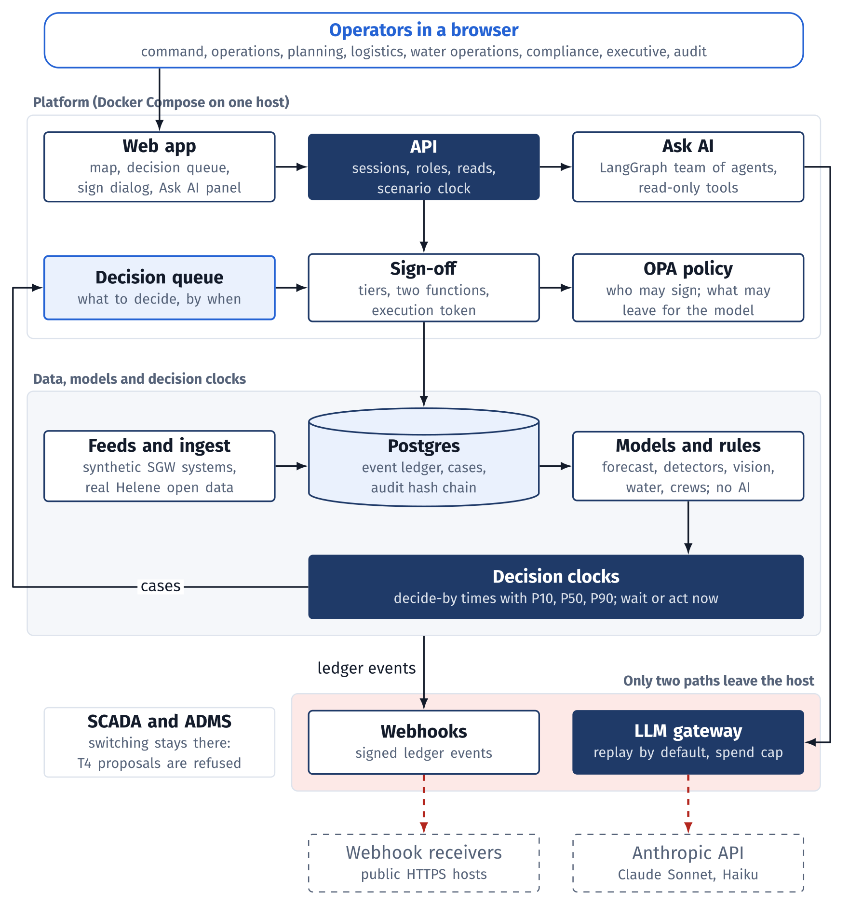
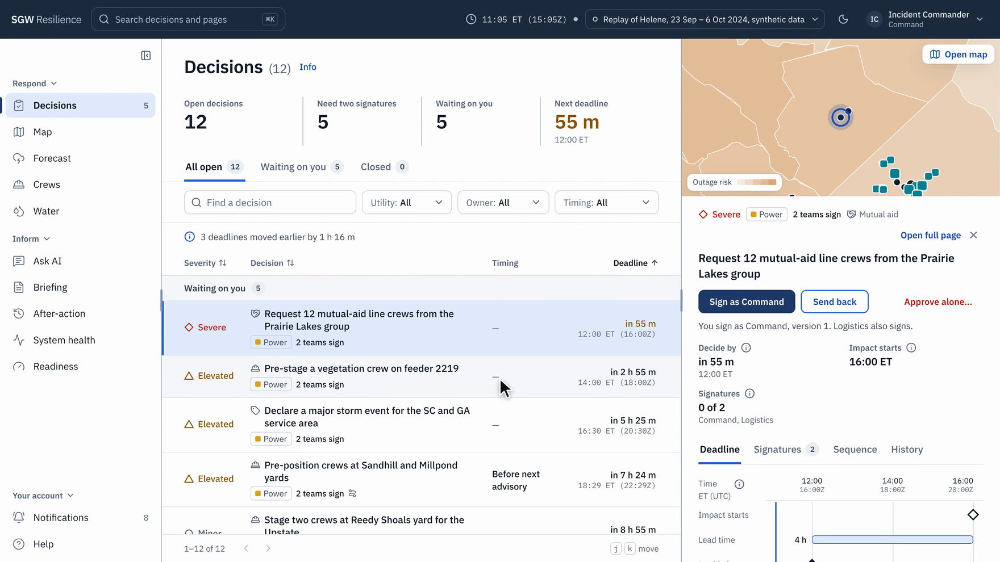
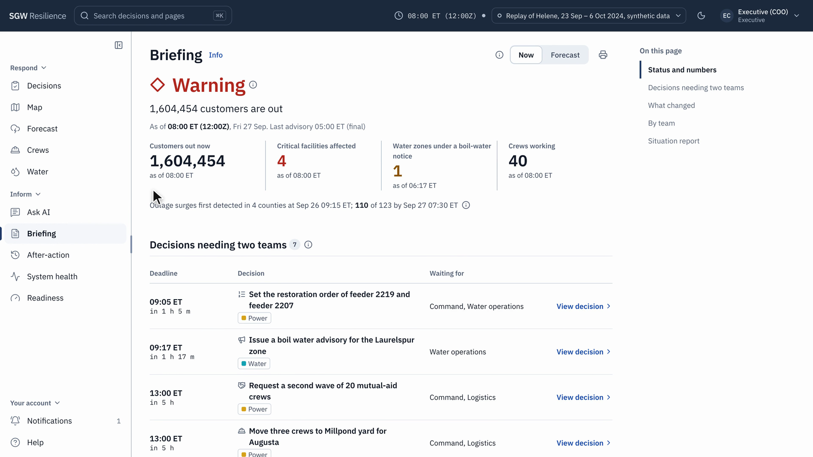

# 01. Overview

Audience: anyone opening the repository for the first time. This page says what the platform does, for whom, and why it is built around deadlines. The other numbered pages go into each part.

## What it is

The SGW Resilience Platform is a working prototype of an AI-enabled decision support platform for Southeastern Grid & Water (SGW), a power and water utility serving over 8 million residents in South Carolina and eastern Georgia (from the case brief). It replays Hurricane Helene (September 2024) on a synthetic SGW network, with real public storm data, and lets the people who run a storm response see what must be decided, by when, and sign those decisions.

The prototype is advisory. It reads data, forecasts, proposes and records. It has no write path to field equipment or control systems.

## The problem

During a hurricane, SGW's information is spread over separate systems: GIS, maintenance and asset systems, weather feeds, outage management, SCADA, meter data and field service tools. Forecasts exist. What goes wrong is timing:

- a mobile generator is ordered after the road to the site has closed;
- a mutual-aid crew request goes out after the window for crews to arrive in time;
- a boil-water notice is drafted after pressure has already fallen below the legal floor.

Each of these actions has a lead time, and each new forecast advisory moves the time by which the action must start. People in the emergency operations centre track these deadlines by hand, across systems, while the forecast keeps changing.

## The main idea: decision clocks

The platform's core object is a **decision case** with a computed **decide-by time**: the latest time an action can be approved so that its lead time still fits before the consequence.

`decide-by = consequence time - action lead time`

The consequence time comes from models run on every member of the forecast ensemble, so each deadline is a range (P10, P50, P90), not a single time. When a new advisory arrives, the deadlines move, and the decision queue reorders. Deterministic code computes every deadline; the AI explains it but cannot set it. How the clock is computed and who signs: [02. Roles and decision workflow](02-roles-and-decision-workflow.md). Why this object: [ADR 0001](adr/0001-decision-clocks-as-the-core.md).

The demo story is one such clock: pump station PS-17 feeds a zone with a hospital. If the station loses power, its tank drains, and the hospital connection falls below the state pressure floor. When the next advisory shifts the storm, that deadline moves earlier, and the Incident Commander and the Water Incident Lead must sign a feeder priority before it passes.

## Who uses it

| Role | What they do in the platform |
| --- | --- |
| Incident Commander | Sees every open decision; signs as `command`; may approve a two-team decision alone in an emergency |
| Duty Managers, Electric Operations | Propose crew staging and event type; sign as `operations`; dispatch crews |
| Logistics Section Chief | Signs crew pre-positioning, mutual aid and field resource orders |
| Water Incident Lead and Water Compliance Officer | Sign boil-water notices and water priorities |
| ETR Specialist | Prepares the global estimated time of restoration (ETR) |
| Executive (COO) | Reads the briefing; may pull the kill switch |
| Auditor | Reads everything, writes nothing |
| Platform Admin, Data and Models Owner | Run the platform, its pipelines and models |

The full permission table is in [02](02-roles-and-decision-workflow.md).

## Pages

| Page | What it shows |
| --- | --- |
| Decisions | Open decisions and their deadlines; sign, send back, emergency approval |
| Map | Assets, storm track and cone, observed gusts, river gauges, warnings and county risk |
| Forecast | Outage forecast, what changed since the last advisory, and what-if questions |
| Crews | Crews, staging yards and crew plans |
| Water | Pressure, boil-water advisories and sensor alerts |
| Ask AI | Questions about the storm response, answered from the platform's data with sources |
| Briefing | The current situation at a glance |
| After-action | What was decided, when and by whom |
| System health | Data feeds, models, AI activity and the stop controls |
| Readiness | Pre-season checks with owners and due dates |
| Notifications, Admin, Help | Alerts per person; users, policies and integrations; a glossary |

Source: `web/src/app/modules.ts`. The UI shows only the pages and buttons the signed-in role may use (`GET /api/me/permissions`).

## AI in the platform

| Capability | Method in short | Page |
| --- | --- | --- |
| Ask AI | a read-only team of LLM agents with a router, planner, parallel workers and a number verifier | [05](05-ask-ai-agent-system.md) |
| Outage forecast | customers out per county with ranges, evaluated leave-one-storm-out on real storms | [06](06-outage-forecast.md) |
| Surge and anomaly detection | outage surge on county series; pressure anomalies in water zones | [07](07-surge-and-anomaly-detection.md) |
| Computer vision | damage photo triage with a published aerial-imagery classifier | [08](08-computer-vision.md) |
| Water network model and what-if | tank drain to the pressure floor per forecast member; a precomputed what-if grid | [09](09-water-network-model-and-what-if.md) |
| Optimisation | crew pre-positioning across forecast members; restoration estimates | [10](10-crew-optimisation-and-restoration-estimates.md) |

The LLM never decides: it writes text with placeholders that code fills with computed values, and a verifier rejects any number it cannot trace ([ADR 0003](adr/0003-llm-explains-never-decides.md)). Without an API key, recorded answers replay at no cost.

## Real and synthetic data

SGW's own data is not available to the prototype, so its network, customers, staff, procedures and storm-day events are synthetic. The storms and the outside world are real public data: NOAA tracks and forecast cones, observed winds, river gauges, warnings, EAGLE-I county outages, federal reports and aerial damage imagery. Every quoted number carries a label (fact, computed, assumption, SGW policy, synthetic). Details: [04. Data](04-data.md).

## Two scenarios

- **Hurricane Helene 2024** is the main scenario: a full replay on synthetic SGW data with real storm data, from before landfall to the after-action review, with seven named demo moments that load in seconds.
- **Hurricane Ian 2022** is a scripted exercise on Ian's real track. Its outages, facilities, crews and eleven timed decisions are scripted and labelled "Scripted exercise data (synthetic)"; Forecast and Water are not modelled for it.

## Read next

[03. Architecture](03-architecture.md) for the containers and trust boundaries, [11. Security, governance and human oversight](11-security-governance-and-human-oversight.md) for the controls, and [12. Assumptions, limitations and improvements](12-assumptions-limitations-and-improvements.md) for what the prototype does not prove.
