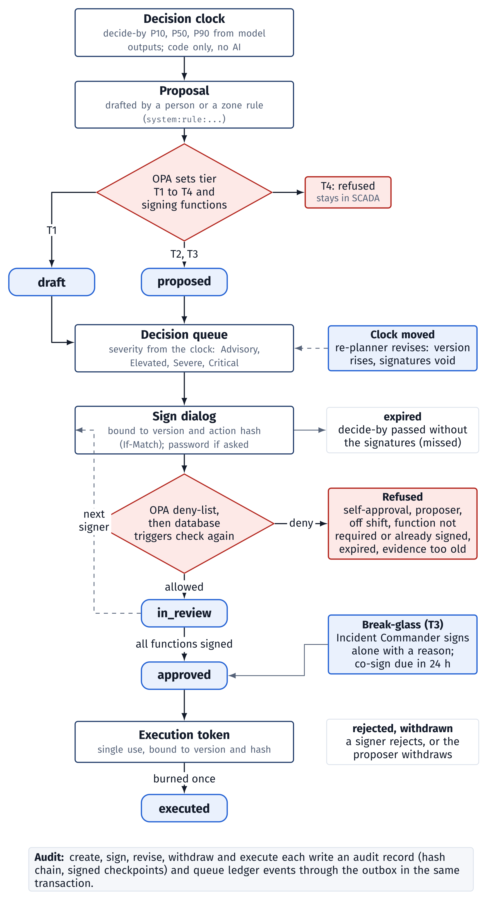
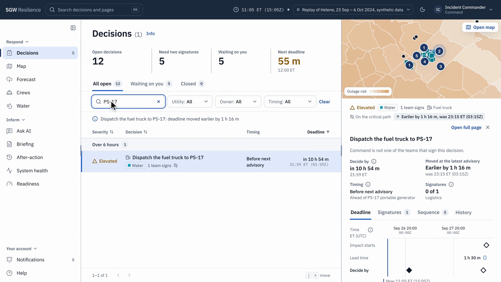
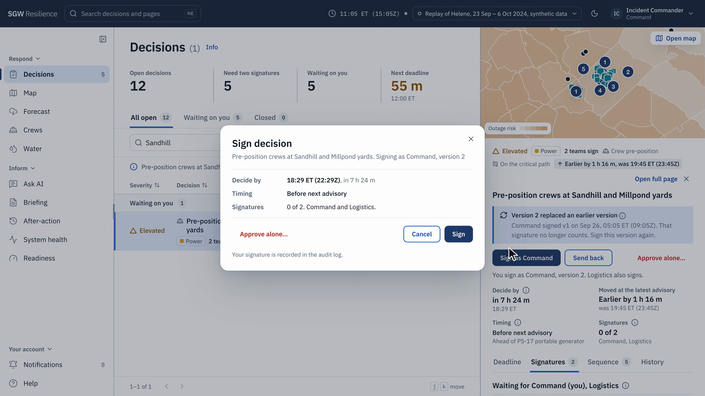
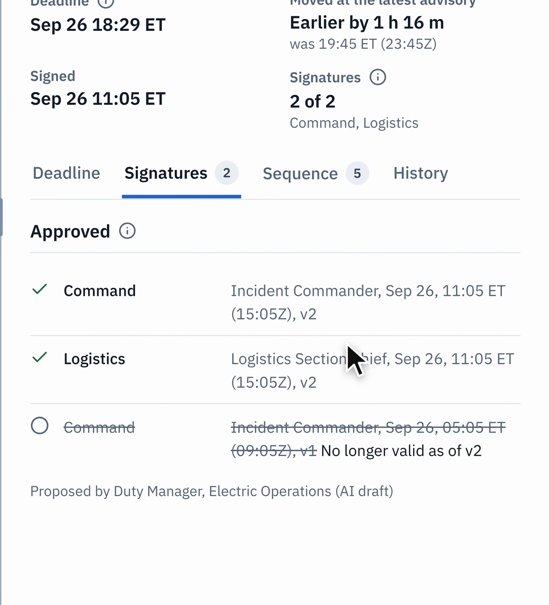
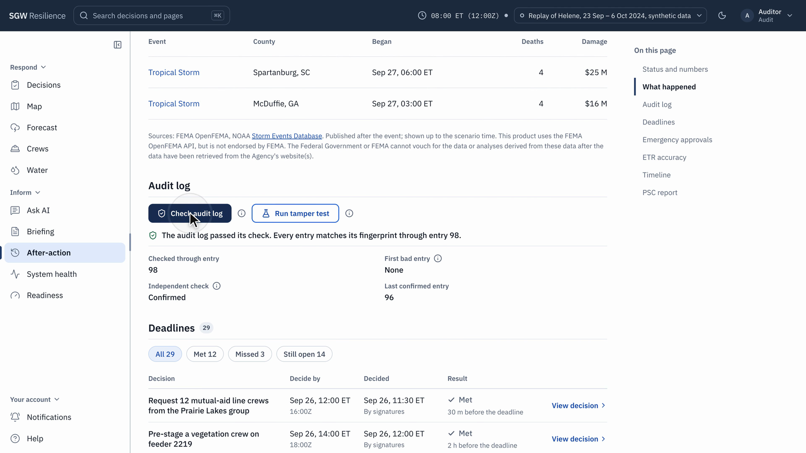

# 02. Roles and the decision workflow

Audience: an assessor who wants to know who may do what, and what happens between "the platform raises a decision" and "the decision is approved and recorded". Each section names the code that implements it.

## Roles

The prototype seeds eleven people across ten functions (`data/seed/users.yaml`). A function is the team a person signs for (command, operations, logistics and so on). Display names are role titles, not people.

| User id | Role | Function | Signs decisions | Emergency approval | Kill switch |
| --- | --- | --- | --- | --- | --- |
| `ic_01` | Incident Commander | command | yes | yes | yes |
| `ops_dm_01` | Duty Manager, Electric Operations | operations | yes | no | yes |
| `ops_dm_02` | Duty Manager (relief) | operations | yes | no | yes |
| `plan_etr_01` | ETR Specialist | planning | no | no | no |
| `log_01` | Logistics Section Chief | logistics | yes | no | no |
| `wtr_lead_01` | Water Incident Lead | water_operations | yes | no | yes |
| `wtr_comp_01` | Water Compliance Officer | compliance | yes | no | no |
| `exec_01` | Executive (COO) | executive | no | no | yes |
| `audit_01` | Auditor | audit | no, read-only | no | no |
| `admin_01` | Platform Admin | platform | no | no | no |
| `ml_01` | Data and Models Owner | data | no | no | no |

Where each permission comes from:

- **Signing** needs `can_approve: true` and a function the decision requires. Both are checked by the approval policy (`policy/approval.rego`, deny reasons `not_an_approver`, `function_not_required`).
- **Read-only.** The auditor role is read-only (`READ_ONLY_ROLES` in `src/sgw/api/sessions.py`). The `Writer` dependency in `src/sgw/api/deps.py` refuses every write from it with `READ_ONLY_ROLE` before any rule runs.
- **Kill switch.** Raising a stop level is open to the roles in the `ops_kill_role` table: incident commander, duty manager, water incident lead and executive (`db/migrations/5000_ops_control.sql`). Lowering it needs two people, one from `command` and one from `compliance` (`RESTORE_FUNCTIONS` in `src/sgw/ops/levels.py`). See [11. Security, governance and human oversight](11-security-governance-and-human-oversight.md).
- **Crew dispatch** is open to the duty manager and logistics chief roles (`ACTOR_ROLES` in `src/sgw/dispatch/policy.py`).
- **Pipeline runs** belong to the `data` and `platform` functions, the **Admin** page to the platform admin role, and **moving the scenario clock** to `command`, `operations` and the presenter role (`src/sgw/api/permissions.py`, `src/sgw/api/deps.py`).

The UI reads the same rules from `GET /api/me/permissions` (`permissions()` in `src/sgw/api/permissions.py`), so a button a role may not use is not shown.

## Decision cases and the decision clock

The platform's core object is a **decision case**: an action that must be decided by a computed time (the "decide-by" time), so that its lead time still fits before the consequence.

How a clock is computed (deterministic code, no LLM):

1. **Consequence time per forecast member.** Each forecast advisory comes with an ensemble of perturbed storm tracks (40 members in the Helene scenario, `forecast.members` in `data/synthetic/family_a.yaml`). For each member, code finds the anchor event (for example the first time the chance of power loss at pump station PS-17 passes its threshold) and adds the durations that follow (for example the time the zone tank takes to drain to the state pressure floor). See `src/sgw/models/clocks/waterfall.py`.
2. **Decide-by.** `decide_by = consequence time - action lead time`. Lead times come from a versioned registry with procedure references (`src/sgw/models/clocks/lead_times.yaml`).
3. **Range.** P10, P50 and P90 are taken over the member totals with linear interpolation. Members that never reach the anchor do not vote. If fewer than a third of the members reach it (`DEFAULT_MIN_MEMBER_SHARE = 1/3`), the case has no clock and says so.
4. **Effective decide-by.** Prerequisites form a directed acyclic graph. A backward pass over it (critical path method, `src/sgw/models/clocks/critical_path.py`) moves a prerequisite's deadline earlier when a dependent needs it done first.
5. **Wait or act.** The no-regret verdict offers "wait for the next advisory" only when that advisory, plus its processing time, lands before the earliest P10 effective decide-by of the case and all its prerequisites; otherwise it says "decide now" (`src/sgw/models/clocks/service.py`).

The decision queue lists open proposals by effective decide-by (`src/sgw/approval/repository.py`, `ORDER BY c.effective_decide_by_utc`). The API's scenario-jobs loop (`src/sgw/api/scenario_jobs.py`, every 5 seconds and after each clock command) recomputes the queue for the advisory in force, revises open proposals whose clock moved (which voids their signatures), marks proposals past their window as expired, and raises the rule and exercise decisions known at the scenario time.

## Proposals and approval tiers

A **proposal** is a concrete action on a decision case: what to do, on which targets, at which version. Proposals come from rules on the scenario clock (`system:rule:...`), from people (the duty managers, the ETR specialist), from agent runs (drafts only) and from the crew optimiser.

The server asks OPA (Open Policy Agent, a policy engine) for the **tier** and the **required functions**. The client never sends a tier (`policy/approval.rego`; the tier table is generated into `policy/sgw/tiers/data.json`).

| Action type | Tier | Who signs |
| --- | --- | --- |
| `work_order_draft`, `sitrep_draft`, `reoptimise_within_envelope` | T1 | A person promotes the draft |
| `set_event_type` | T2 | command |
| `stage_crews_small` | T2 | operations |
| `field_resource_order` (tanker, fuel, mobile generator) | T2 | logistics |
| `policy_change` | T2 | compliance |
| `preposition_crews`, `mutual_aid_request` | T3 | command and logistics |
| `cross_domain_priority` (for example PS-17 feeder priority) | T3 | command and water_operations |
| `boil_water_notice`, `lift_boil_water_notice` | T3 | water_operations and compliance |
| `publish_global_etr` | T3 | command and operations |
| anything not in the table | T4 | refused: no tool exists |

**Escalation.** A T2 action becomes T3, with the escalated pair of functions, when it affects at least 1,000 customers, has more than ten targets, carries a risk flag (critical facility, hazard zone entry, irreversible, untrusted evidence only, conflicting sources and others) or the platform is in a degraded mode (`escalators` in `policy/approval.rego`, limits in `policy/sgw/tiers/data.json`).

**Approval window.** An open proposal expires after a time limit per tier on the scenario clock: 240 minutes for T1, 120 for T2, 60 for T3 (`TIER_TTL_MIN` in `src/sgw/contracts/approval.py`). An expired proposal takes no more signatures.

## Two-team sign-off

A T3 decision needs two people from two different functions, neither of them the proposer.

What happens when someone presses **Sign** (`ApprovalService.decide` and `_record` in `src/sgw/approval/service.py`):

1. The request carries the proposal version and action hash, and an `If-Match` header with the same pair. If the proposal changed since the person opened it, the API answers 412 and the dialog shows the newer version.
2. OPA checks the signature. It refuses, among others, self-approval, a function the person does not hold, a function the decision does not require, a function or a person that has already signed, a person off shift, and an expired proposal.
3. The signature row is written. If every required function has now signed, from distinct people who are not the proposer, the proposal becomes `approved` and a single-use **execution token** is issued, bound to that version and action hash. Otherwise it stays `in_review` with the functions still missing.
4. Database triggers check the same rules again on insert (`db/migrations/4500_approval_execution_token_binding.sql`): a token can exist only for an approved proposal whose current version carries every required function from distinct non-proposers. A direct SQL insert by the runtime role is refused too.
5. A material change to the proposal (for example its targets) changes the version and the action hash and voids the earlier signatures and token (security test `tests/security/test_sec_47.py`).

**Withdraw.** The proposer may withdraw an open proposal. An approver may withdraw their own signature while the proposal is still in review. An approved T3 action cannot be withdrawn; it is rescinded by a new T3 proposal (`ApprovalService.withdraw`).

## Send back

**Send back** is a reject with a note ("What is missing?", `web/src/features/decisions/SignDialog.tsx`). The proposal moves to `rejected`, an unburned token is dropped, and the audit record keeps the reason (`_record` in `src/sgw/approval/service.py`). A rejected proposal takes no more signatures; a new proposal for the same decision case can be raised.

## Emergency approval (break-glass)

When the second team cannot sign in time, the Incident Commander may approve a T3 action alone. The code calls this break-glass (`src/sgw/approval/breakglass.py`, `policy/breakglass.rego`, values in `policy/sgw/governance/data.json`).

| Rule | Value in code |
| --- | --- |
| Applies to | T3 proposals that are still open (`proposed`, `in_review`, `escalated`) |
| Who | a person with the `command` function and `break_glass_eligible: true` (only `ic_01`), not the proposer, on shift |
| Reason | required, at least 10 characters |
| Password | re-entered within the last 5 minutes (`SteppedUp` dependency, `STEP_UP_TTL_S = 300`) |
| How often | once per proposal |
| Co-sign | a holder of the other required function, not the IC and not the proposer, within 24 hours |

In one transaction the service writes the break-glass row, sets the proposal to `approved`, issues the execution token, opens a co-sign task due in 24 hours and writes an audit record flagged for the after-action review. After commit it signs the audit head at once instead of waiting for the next periodic checkpoint. A late co-sign is still recorded and the use stays flagged (`cosign`, `flag_overdue`). Break-glass rows are never deleted (`db/migrations/4750_breakglass_authority.sql`).

## Execution

An approved action is "executed" by burning its token and writing an **effect** row. A trigger refuses an effect without a burned token, and a token can be burned only once (`db/migrations/4501_approval_effect_needs_burned_token.sql`). The prototype has no write path to field equipment or control systems: an effect is a record, and T4 actions have no tool at all.

## Audit trail

Every state change appends a row to the `audit_event` table (`src/sgw/approval/audit.py`, `src/sgw/api/audit_log.py`).

- **Hash chain.** Each row stores `prev_hash` and `hash = sha256(canonical JSON of the header)`. The header holds the stream, sequence, event key, time, actor, kind, subject, the SHA-256 of the payload and the previous hash (canonical JSON per RFC 8785). Changing any row breaks every later link.
- **Insert-only.** The runtime database role the API uses may insert and read audit rows, never update or delete them ([ops/stack.md](ops/stack.md), "Database layout").
- **Signed checkpoints.** The `audit-checkpoint` container signs the chain head with an Ed25519 key every 60 seconds and writes an anchor file outside the database. The file repeats the signed head and the row hashes since the previous checkpoint under a second signature. The API never holds the private key.
- **Verify.** `uv run sgw audit verify` or `POST /api/audit/verify` walks the chain from sequence 1 and reports the first bad sequence: a gap, a broken link, a hash that does not recompute, or a row that differs from the notarised segment. This holds even when an attacker with superuser rights recomputes every later hash (security test `tests/security/test_sec_52.py`).

Rows written after the newest checkpoint are protected only by the chain until the next checkpoint; see [12. Assumptions, limitations and improvements](12-assumptions-limitations-and-improvements.md).
