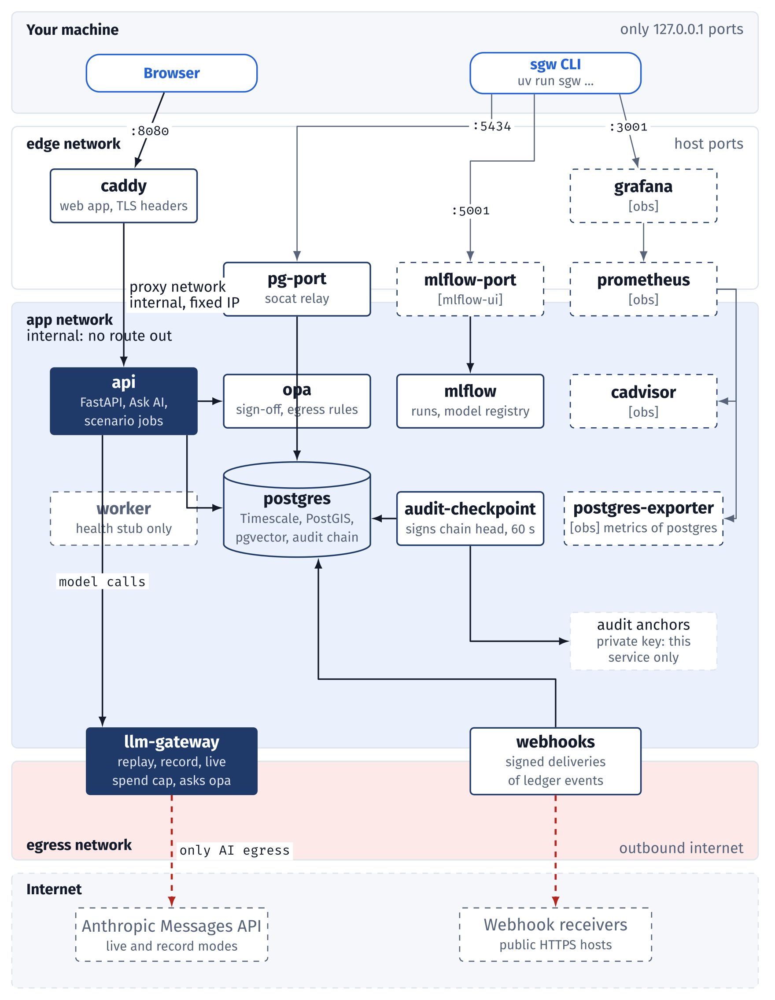
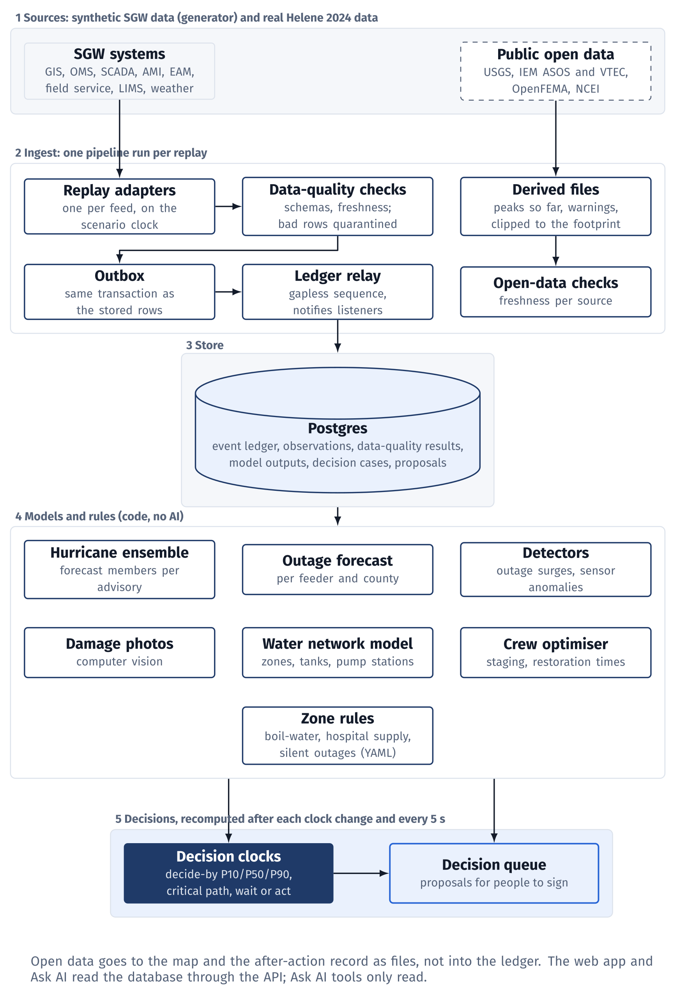
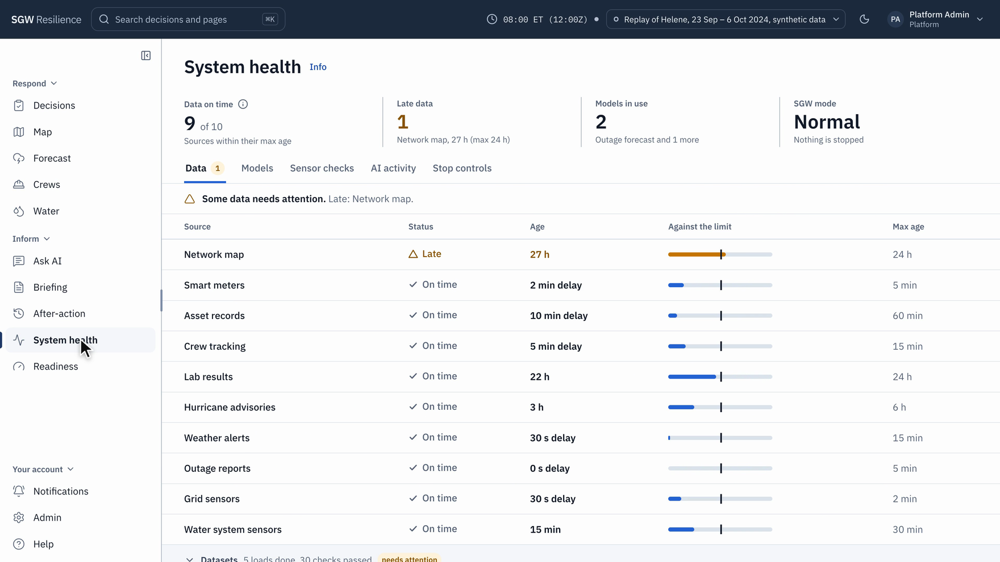

# 03. Architecture

Audience: an engineer or assessor who wants to see how the prototype is built and where its trust boundaries are. This page is the overview. The full service list with images, ports and limits is in [ops/stack.md](ops/stack.md); a guided walk through twelve key files is in [code-tour.md](code-tour.md); the longer reference with every data-flow step is [architecture.md](architecture.md).

## Three design rules

1. **Models predict, code computes, the LLM explains.** Forecasts come from statistical and physical models, deadlines and rankings from deterministic code. LLM text only explains values that code has already computed ([ADR 0003](adr/0003-llm-explains-never-decides.md)).
2. **Authority is a database row.** OPA decides who may approve, and Postgres triggers check the same rules again ([ADR 0002](adr/0002-authority-is-a-database-row.md), [02](02-roles-and-decision-workflow.md)).
3. **One process talks to the LLM provider.** The LLM gateway holds the API key and asks the egress policy before every call ([ADR 0004](adr/0004-single-egress-gateway.md)).

## Containers and networks

The stack is one Docker Compose project (`compose.yaml`). Services without a profile form the core stack.

| Service | What it does | Networks | Code |
| --- | --- | --- | --- |
| caddy | The only HTTP entry: serves the web app, proxies `/api`, sets the CSP on the UI | edge, proxy | `docker/caddy/`, `infra/caddy/` |
| api | FastAPI: sessions, REST and SSE, approvals, audit, scenario clock, agent runs, Ask AI | app, proxy | `src/sgw/api/` |
| worker | Placeholder process today; background jobs are started from the CLI | app | `docker/python/placeholder.py` |
| webhooks | Delivers HMAC-signed webhooks to external systems | app, egress | `src/sgw/integrations/` |
| audit-checkpoint | Signs the audit chain head every 60 s and writes anchor files | app | `src/sgw/approval/audit.py` |
| llm-gateway | Proxy to the Anthropic Messages API: egress policy, record and replay, budget, `llm_call` rows | app, egress | `services/llm_gateway/` |
| opa | Open Policy Agent: approval, break-glass, envelope, dispatch and egress policies | app | `policy/*.rego` |
| postgres | Every table: ledger, observations, decision cases, proposals, audit, retrieval chunks, agent checkpoints | app | `db/migrations/`, `docker/postgres/` |
| pg-port | TCP relay so host tools reach Postgres on 127.0.0.1:5434 | edge, app | `compose.yaml` |
| mlflow | Run tracking for models and agent traces | app | `docker/mlflow/` |

Optional profiles: `mlflow-ui` adds a relay for the MLflow UI on 127.0.0.1:5001; `obs` adds Prometheus, Grafana, cAdvisor and a Postgres exporter.

**Networks** (`networks:` in `compose.yaml`):

- `app` is `internal: true`. Containers that sit only on it (api, worker, audit-checkpoint, opa, postgres, mlflow) have no route to the Internet.
- `proxy` is a second internal network between Caddy and the API, with Caddy on a fixed address. Uvicorn trusts `X-Forwarded-*` headers only from that address (`--forwarded-allow-ips`), so no other container can fake a client address.
- `edge` carries the published ports. Every published port binds to 127.0.0.1.
- `egress` is the only network with a route out. Two services join it: `llm-gateway` (the only path to the LLM provider and the only holder of the key) and `webhooks` (delivery to subscriber URLs). The webhook worker refuses targets that are, or resolve to, loopback, private, link-local, multicast or reserved addresses unless they are listed in `SGW_WEBHOOK_ALLOW_HOSTS` (`src/sgw/integrations/urls.py`).

**Container hardening** ([ops/stack.md](ops/stack.md), "Boundaries"): non-root users, read-only root filesystems except Postgres, `cap_drop: ALL`, `no-new-privileges`, memory limits without swap, base images pinned by digest. The OPA server accepts only decision queries with a bearer token; policy writes over its API are denied (`infra/opa/authz.rego`).

## Trust boundaries

| Boundary | Control | Where |
| --- | --- | --- |
| Host to stack | Ports on 127.0.0.1 only; Postgres only through the relay | `compose.yaml` |
| Stack to Internet | `app` and `proxy` are internal; only the gateway and the webhook worker join `egress` | `compose.yaml` |
| Browser to API | Session cookie (the database stores only its SHA-256), session-bound CSRF token on every write, password re-entry for emergency approval, co-sign and a kill-switch restore | `src/sgw/api/security.py`, `src/sgw/api/deps.py` |
| Data to the LLM | Egress policy per call: data classes per route, node allowlist, canary and secret detectors; fails closed | `policy/egress.rego`, `services/llm_gateway/egress.py` |
| LLM text to the operator | The verifier rejects any digit, number word, link or authority claim the run cannot trace; the template is used instead | `src/sgw/agent/render/verify.py` |
| Operator to action | OPA tier policy, then database triggers on approvals, tokens, effects and break-glass rows | `policy/approval.rego`, `db/migrations/4500_*`, `4501_*`, `4750_*` |
| Process to database | Separate logins: owner for migrations, `sgw_runtime` for the API (insert-only on ledger and audit), `sgw_gateway` (insert on `llm_call` only) | [ops/stack.md](ops/stack.md), "Database layout" |

Security controls in more detail: [11. Security, governance and human oversight](11-security-governance-and-human-oversight.md).

## Data flow from feeds to decisions

1. **Ingest.** Adapters implement one port (contract K6, `src/sgw/contracts/adapter.py`). The replay adapter serves committed fixture events page by page, gated by the scenario clock, and can inject deterministic faults: gaps, delays, duplicates, out-of-order events, schema drift, floods (`src/sgw/ingest/adapters/replay.py`, `src/sgw/ingest/faults.py`). A live NWS alerts adapter exists (`src/sgw/ingest/adapters/nws.py`) and is tested on recorded payloads; the containers that would run it have no route out.
2. **Ledger.** Producers write events to a transactional outbox in their own transaction. One relay moves them into the `event` ledger under an advisory lock, so sequence numbers stay gapless even when a batch rolls back; duplicates are acknowledged without a number; rows the database refuses are quarantined (`src/sgw/ingest/relay.py`).
3. **Models.** Forecast, water twin, detectors, photo triage and the crew optimiser write versioned outputs. Each one has its own page: [06](06-outage-forecast.md) to [10](10-crew-optimisation-and-restoration-estimates.md).
4. **Clocks.** Deterministic code turns model outputs into decision cases with P10/P50/P90 deadlines ([02](02-roles-and-decision-workflow.md)).
5. **Rules on the scenario clock.** The API's scenario-jobs loop runs every 5 seconds: it recomputes the queue, revises proposals whose clock moved, expires old ones, and raises zone-rule and exercise decisions (`src/sgw/api/scenario_jobs.py`).
6. **Proposals and approvals.** People sign in the Decisions page; policy and triggers decide what counts ([02](02-roles-and-decision-workflow.md)).
7. **Out.** The browser gets live updates over Server-Sent Events: `/api/stream/ops` replays the ledger from `Last-Event-ID` and then streams new rows (`src/sgw/api/stream.py`, [ADR 0006](adr/0006-sse-over-websocket.md)). External systems use the `/v1` API with scoped read tokens and signed webhooks (`contracts/openapi-v1.json`).

## Ask AI and the models

Ask AI is a read-only LangGraph agent team: a router and gate decide whether a question is in scope, a planner gives parts of it to up to three workers that read evidence through read-only tools, and a synthesis step writes one answer that the same verifier checks. It has no tool that writes. Details: [05. Ask AI agent system](05-ask-ai-agent-system.md).

The non-LLM AI parts are the outage forecast ([06](06-outage-forecast.md)), surge and anomaly detection ([07](07-surge-and-anomaly-detection.md)), damage photo triage ([08](08-computer-vision.md)), the water network model and what-if grid ([09](09-water-network-model-and-what-if.md)) and crew optimisation with restoration estimates ([10](10-crew-optimisation-and-restoration-estimates.md)).

## Technology choices

| Choice | Why | Record |
| --- | --- | --- |
| Decision case with a computed clock as the core object | A risk score does not say when to act or who signs | [ADR 0001](adr/0001-decision-clocks-as-the-core.md) |
| OPA plus Postgres triggers for authority | One missed check in one route cannot approve an action | [ADR 0002](adr/0002-authority-is-a-database-row.md) |
| LLM writes slots; code fills numbers; a verifier checks | No untraceable number reaches an operator | [ADR 0003](adr/0003-llm-explains-never-decides.md) |
| One LLM gateway | One place for the key, data classes, budget and call records; replay without a key | [ADR 0004](adr/0004-single-egress-gateway.md), [gateway.md](gateway.md) |
| Postgres as the only data store | Runs on one laptop; one store to secure; no dual writes | [ADR 0005](adr/0005-postgres-only-light-stack.md) |
| SSE for server-to-client, REST for writes | Resumable streams over plain HTTP; writes stay idempotent and auditable | [ADR 0006](adr/0006-sse-over-websocket.md) |
| FastAPI, LangGraph, React with Vite, Tailwind CSS and shadcn/ui, MapLibre GL | Typed Python API and agent graphs; a fast typed web client with an offline map | `pyproject.toml`, `web/package.json` |

What each choice costs and when to revisit it: [tradeoffs.md](tradeoffs.md).

## Database and extensions

One Postgres 18 instance (TimescaleDB HA image, pinned by digest) holds everything. `sgw db-smoke` checks eight extensions (`REQUIRED_EXTENSIONS` in `src/sgw/cli/support.py`):

| Extension | Used for |
| --- | --- |
| TimescaleDB | the observation hypertable (time series) |
| PostGIS | geometry of assets, zones and counties |
| pgvector, pgvectorscale | procedure embeddings for retrieval |
| btree_gist | exclusion constraints |
| pgcrypto | cryptographic functions in SQL (for example `gen_random_uuid()` key defaults) |
| H3, pgRouting | carried by the image and checked by `sgw db-smoke`; no migration or application code uses them yet |

Postgres also serves as the job queue (`FOR UPDATE SKIP LOCKED` with a lease), the live push signal (`NOTIFY sgw_ledger` after each relay commit), the LangGraph checkpointer (an agent run paused for approval survives an API restart) and the hash-chained audit store ([ADR 0005](adr/0005-postgres-only-light-stack.md)).

## Platform health

The System health page shows the state of data feeds, models, AI activity and the stop controls (`web/src/app/modules.ts`). Admin > System metrics shows the API's own request counts and response times since the process started (`GET /api/admin/system`); long-term metrics need the optional `obs` profile.

