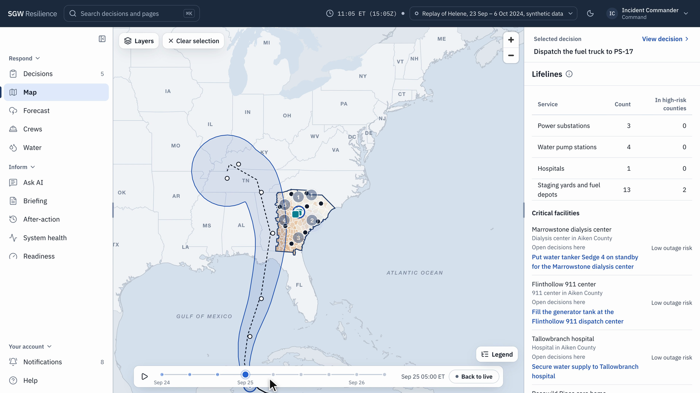
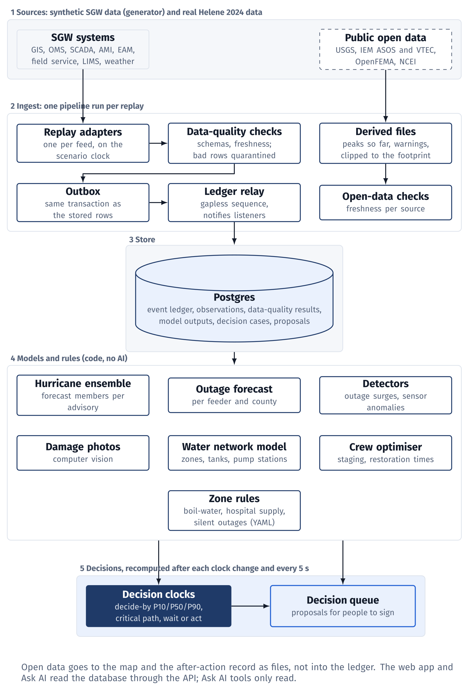

# 04. Data

Audience: an assessor who wants to know which data in the prototype is real, which is invented, and how it moves through the platform. The full dataset tables with paths and rebuild commands are in [data.md](data.md); licences and per-file sources are in [data/ATTRIBUTION.md](../data/ATTRIBUTION.md).

## The rule: real storm, synthetic utility

SGW's own systems are not available to the prototype, so everything about SGW is synthetic: its network of feeders and pump stations, customers, assets, staff, procedures and the storm-day events in its own systems. Real public data supplies the storm and the outside world: tracks, forecast cones, observed winds, river gauges, warnings, county outage counts, federal reports and aerial damage imagery. The synthetic data is calibrated to the real data or evaluated against it. Real storms keep their names.

## Real public data

| Source | What it gives the platform |
| --- | --- |
| NOAA NHC HURDAT2 best tracks (24 storms, 2016-2025) | storm tracks for the generator, the hazard features and the outage evaluation; the Ian track |
| NHC GIS archive, Helene advisories 5-16 | forecast cone and track on the map |
| ORNL EAGLE-I county outages, 15-minute series | outage forecast targets, customers per county, surge detector replay |
| ASOS stations via Iowa Environmental Mesonet | observed gusts on the map, hazard check, heat and fire-weather triggers |
| USGS NWIS river gauges (148), NWS warnings via IEM | map layers |
| OpenFEMA declarations, NCEI Storm Events | after-action public record; surge detector labels |
| DOE CESER Helene situation reports, EPA incident checklists | federal documents in the procedure corpus |
| LADI v2 aerial imagery (200 thumbnails) and its reference classifier | damage photo triage ([08](08-computer-vision.md)) |
| US Census county outlines, Natural Earth basemap | offline map |
| EIA electricity data | inputs to the ROI model of the executive briefing |

Totals computed from EAGLE-I in this repository are our own aggregation, not utility or DOE figures. Missing 15-minute rows count as zero, because the source does not tell zero from a gap ([data.md](data.md)).

## Synthetic SGW data

| Data | How it is made |
| --- | --- |
| Helene scenario: feeders and sections over the footprint counties, advisories with forecast ensembles, outages, restoration, pump stations, tanks, generators, fuel, telemetry | deterministic generator `src/sgw/generator/` (seeded random streams per subsystem and entity, SHA-256 manifest per file), calibrated to the real track, EAGLE-I county peaks and ASOS gusts; `uv run sgw data generate --scenario helene` |
| Held-out "family B" world on the real Debby 2024 track | same generator with shifted parameters (`data/synthetic/family_b.yaml`); never used to train or tune |
| Water zone networks and the drain grid | `src/sgw/models/water/`, `host/water_twin/precompute.py` ([09](09-water-network-model-and-what-if.md)) |
| Procedure corpus, 120 documents | hand-written and template-generated in the style of real utility documents; no text copied |
| Seeded people, 11 users across ten functions | `data/seed/users.yaml` ([02](02-roles-and-decision-workflow.md)) |
| Exercise injects on the Helene timeline (31 decisions, 20 facilities) | scripted in `src/sgw/rules/injects.py`, labelled scripted exercise data |
| Hurricane Ian 2022 exercise pack | hand-written YAML on the real Ian track (below) |

Every number the documents, the UI or the video quote lives in the numbers registry `data/numbers/numbers.yaml` with a value, unit, source and label: F fact, C computed, A assumption, P SGW policy (assumed), S synthetic, U unverified ([data.md](data.md), "Labels").

## How data comes in

All feeds enter through one adapter interface (contract K6, `src/sgw/contracts/adapter.py`). In the prototype the feeds are replayed:

1. **Replay adapter.** Each source's committed fixture events are served page by page with an opaque cursor, gated by the scenario clock, so an event appears only once its time has come (`src/sgw/ingest/adapters/replay.py`).
2. **Fault injection.** Environment flags reshape a feed in a deterministic way, so a faulted replay is as repeatable as a clean one: `FAULT_FEED_DELAY`, `FAULT_FEED_GAP`, `FAULT_FEED_DUPLICATE`, `FAULT_FEED_OUT_OF_ORDER`, `FAULT_FEED_SCHEMA_DRIFT`, `FAULT_FEED_FLOOD_10X` (`src/sgw/ingest/faults.py`).
3. **Outbox and ledger.** Events are written to an outbox in the producer's transaction; one relay moves them into the gapless `event` ledger, acknowledges duplicates by their key and quarantines rows the database refuses (`src/sgw/ingest/relay.py`). `uv run sgw replay` prints the ledger head, a gapless flag and its SHA-256.

A live adapter for NWS active alerts exists (`src/sgw/ingest/adapters/nws.py`) and is tested on recorded payloads. The stack gives it no route to the Internet, so the demo runs on replayed data only.

## The scenario clock

Every page shows the same scenario time, not the wall clock. The time is a pure function of an anchor:

`scenario time = anchor scenario time + (wall time - anchor wall time) x speed`

clamped to the scenario window and stored in `control_state.scenario_clock`, so every process derives the same time (`src/sgw/api/clock.py`). Speeds are 0 (paused), 1, 60 and 900. Only `command`, `operations` and the presenter role may move the clock (`clock_operator` in `src/sgw/api/deps.py`). After each clock command, and every 5 seconds, the scenario-jobs loop raises the decisions known at the new time ([02](02-roles-and-decision-workflow.md)).

**Demo moments.** For a fast demo, eight moments of the Helene story are built as template databases from one driven story run (`sgw demo build`, `src/sgw/demo/bookmarks.py`). "Load moment" (`POST /api/demo/goto`, demo mode only) replaces the API's database with that copy in seconds. The UI offers seven of them (`JUMP_LABEL` in `src/sgw/api/scenario_info.py`); the eighth, "PS-17 priority and boil-water notice signed", is not in the UI list; `uv run sgw demo goto signed` loads it.

| Moment in the UI | Scenario time (UTC) |
| --- | --- |
| Before the 5 AM advisory | 2024-09-26 08:00 |
| 5 AM advisory | 2024-09-26 09:05 |
| 11 AM advisory: deadlines move | 2024-09-26 15:05 |
| Morning after landfall | 2024-09-27 12:00 |
| Restoration estimate published | 2024-09-28 18:00 |
| Boil-water notices lifted | 2024-09-30 12:00 |
| After-action review | 2024-10-06 02:00 |

## Scenarios

| Scenario | What is real | What is scripted or synthetic | Pages |
| --- | --- | --- | --- |
| Hurricane Helene 2024 (default) | track, NHC cone, gusts, gauges, warnings, county outages | the SGW network, its outages, telemetry, crews and decisions | all |
| Hurricane Ian 2022 exercise pack (`data/scenarios/ian-2022/`) | the HURDAT2 best track (no cone shipped) | three moments (day before landfall, landfall near Georgetown, morning after), a county outage curve, critical facilities, a crew roster and eleven timed decisions (`msel.yaml`), all labelled "Scripted exercise data (synthetic)" | Decisions, Map, Briefing, Notifications, Crews (read-only), After-action; Forecast and Water show "Not modelled for this scenario" |
| Heat wave (July 2024), Table Rock fire weather (March 2025) | ASOS station series | trigger rules | Readiness previews |

The active scenario is part of the scenario clock, so every user sees the same one. Loading a pack (`POST /api/demo/scenario`) first copies the quiet Helene template, so no Helene decision or signature carries over (`src/sgw/scenarios/packs.py`, [architecture.md](architecture.md), "Scenarios").

## What is not in the repository

No utility customer data, no personal data beyond the seeded synthetic identities, no API keys, and no full-size LADI images (downloaded on demand into the git-ignored `var/cv/`).
