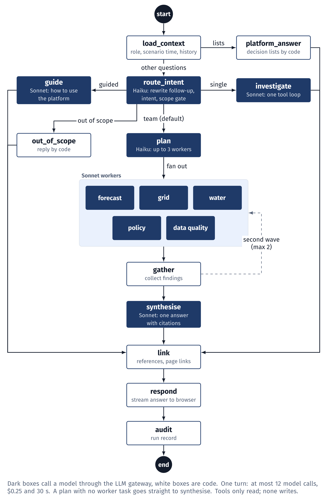
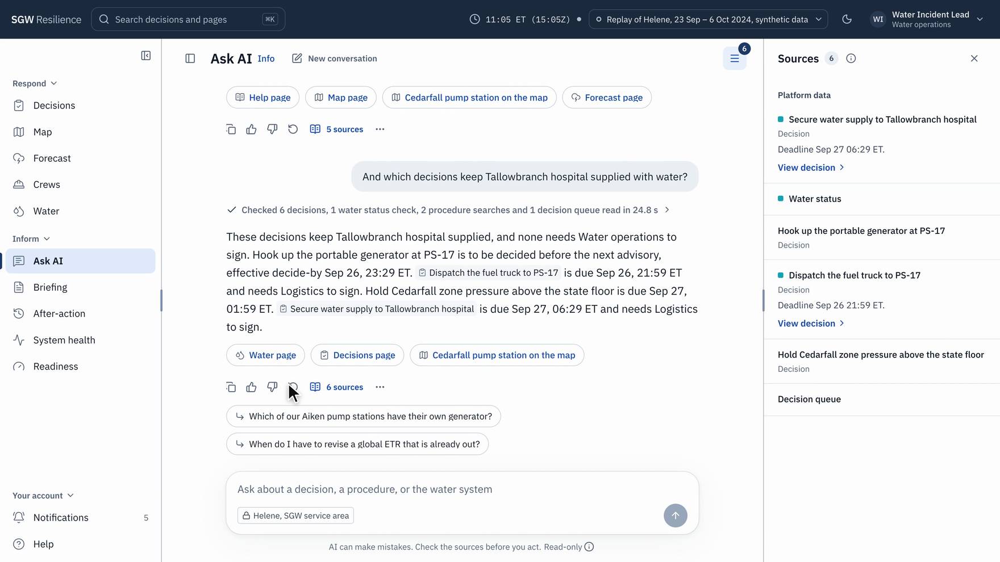

# 05. Ask AI: the agent system

Ask AI answers questions about the storm in plain words: what is out, which decisions are due, what a procedure requires, where a page is. It supports every SGW decision only as a reader. It never drafts, proposes, approves or sends anything, and the graph has no approval step. Signing stays with people (see [02-roles-and-decision-workflow.md](02-roles-and-decision-workflow.md)).

## How a question is answered

The graph is built with LangGraph in `src/sgw/agent/copilot/graph.py` (`build`). One user turn walks these nodes:

1. **load_context.** Keeps only `question` and `as_of` (the scenario time the user looks at). Other input keys are dropped and audited. Role, data ceiling and region come from the signed-in session, never from the request. The question is cut at 2,000 characters and at most the last 3 turns of history are kept.
2. **Code-first check (`after_load`).** A question that asks for a list of decisions ("Which decisions ...", or a time window plus decisions) goes to `platform_answer`. Code reads the decision queue and writes the answer. No model is called, because model prose added only errors there.
3. **route_intent.** Three small steps run in one node:
   - `ask_contextualise` turns a follow-up ("and for PS-23?") into one standalone question. Only a turn that leans on the conversation is rewritten; ids the user typed must survive.
   - `route_intent` picks one intent from a closed list: `qa`, `metric`, `assess`, `plan`, `sitrep`, `what_if`, `out_of_scope`, plus registry entity ids. Instruction-like sentences ("ignore previous", SQL, "approve") are withheld first and the run is marked tainted.
   - `triage_intent`, the wide gate, takes a second look. Code decides first, in order: a request to change something becomes `write`; instruction-like text only becomes `injection`; a photo request becomes `photos`; a "where can I find" question becomes `navigate`. Only when none of these match does the model choose among overview, data, photos, navigate, explain, unclear, unrelated and write, with 2 or 3 "did you mean" readings.
4. **Branch (`after_route`).** Gate kinds navigate, explain, photos, unclear and the three refusals (unrelated, write, injection) go to **guide**. An out-of-scope intent goes to `out_of_scope`. Everything else goes to **plan** (the default `team` engine; `SGW_COPILOT_ENGINE=single` selects the older single loop `investigate`).
5. **plan.** The planner (`ask_plan`) splits the question into tasks for 1 to 3 analysts, with an optional follow-up wave. Code then checks the plan: unknown or role-denied workers are dropped, each worker appears once, entity ids are kept only when they are registry ids. A whole-situation question always gets the grid and water analysts (`overview_plan`). If the model is unavailable, code plans from keywords and entity ids.
6. **Parallel workers.** `fan_out` sends each task to a `worker` with LangGraph `Send`, so they run at the same time. Each worker first fetches up to 4 evidence reads by code, then takes at most 3 model steps with at most 2 extra platform tool calls of its own (decision-case and water-status reads are counted apart, up to 6). A worker's request depends only on its own task, so the finishing order cannot change any request.
7. **gather and second wave.** After the first wave, a planned follow-up worker may run once (at most 2 waves), unless half of the turn's time budget is already gone.
8. **synthesise.** Findings are merged in a fixed order (worker order, then wave), evidence items are renumbered, and one writer step (`ask_synth`) answers. If the checks below fail, the writer gets one rewrite request with the failed check codes, up to 3 calls in all. If it still fails, code renders the evidence as a short plain answer (the "M2" fallback).
9. **link.** Code, not the model, turns ids named in the answer into typed links (decision, asset, county, cited passage, photo). A link is made only for an id that belongs to this run, so model text cannot invent a link.
10. **respond and audit.** Only the checked, rendered text leaves the graph. Every step, tool call, gate result and verifier rejection is written to the run's audit trail.

The **guide** node (`ask_guide`, `src/sgw/agent/copilot/guide.py`) writes navigation answers, explanations, photo answers and helpful refusals: a refusal always offers questions the user can ask instead.

## The five analysts and their read-only tools

| Worker | Covers | Tools |
| --- | --- | --- |
| forecast | hurricane track and timing, outage forecast, asset risk, precomputed what-if scenarios | `get_forecast`, `get_risk`, `run_what_if` |
| grid | feeder outages, county outage surges, restoration times, crews and plan, damage photos, decision queue | `get_outages`, `get_crews`, `get_etr`, `list_outage_surges`, `get_damage_photos`, `list_decisions`, `get_decision_case` |
| water | pump stations, zones, tanks, generators, sensor anomalies, water decisions | `get_water_status`, `list_anomalies`, `get_decision_case`, `list_decisions` |
| policy | SGW plans, procedures, contracts and field records in force | `search_procedures`, `get_readiness`, `get_decision_case` |
| data_quality | feed freshness, sensor spoofing, outage-data dropouts | `get_feed_health`, `list_anomalies`, `list_outage_surges` |

All of these tools have `side_effect="none"` in `src/sgw/contracts/tools.py`. Two further tools, `draft_proposal` (the only one with a side effect, `side_effect="draft"`) and `optimise_prepositioning`, are marked `model_visible=False`, so no model ever sees them. A role filter offers a worker only the tools its role may call and refuses any other call.

## Which model runs each node, and why

Models and effort come from `src/sgw/agent/llm_nodes.yaml`. The gateway reads the same file to enforce which model a node may call.

| Node | Model | Effort | Why |
| --- | --- | --- | --- |
| `ask_contextualise`, `route_intent`, `triage_intent` | Haiku | low | short structured choices; route eval 30 of 30 on Haiku |
| `ask_plan` | Haiku | low | on the dev plans Haiku matched Sonnet at a fraction of the cost |
| `ask_worker_*` (5 analysts) | Sonnet | medium | Sonnet scored equal or higher than Haiku on every worker; Haiku hit its token limit |
| `ask_synth` (writer) | Sonnet | medium | writes the user-facing answer |
| `ask_guide` | Sonnet | medium | writes every guide and refusal answer |
| `investigate` (single loop) | Sonnet | medium | the older loop, kept as an alternative engine |

The per-node comparisons are small, provisional runs with code graders, recorded in `data/artefacts/evals/` (`ask_team_nodes_dev_v1.json`, `wp21_route_eval_v1.json`). They guide the choice; they are not proof of quality on their own. The end-to-end question bank below is the main measure.

## How numbers in an answer are checked

A model may not type a number. It writes slots such as `{E3.customers_out}`, which point to field `customers_out` of evidence item 3, and code fills in the value from the tool result. The verifier (`src/sgw/agent/render/verify.py`, `verify`, called from `finalise` in `src/sgw/agent/copilot/investigate.py`) rejects an answer when:

- a slot names evidence or a field that does not exist, or a brace is left over;
- any token with a digit outside a slot is not exactly an id from this run's evidence, the asset and document registry, or the closed list of step codes (an invented `PS-91` fails);
- it contains a number word (zero to ninety, hundred, dozen, half, twice, percent and so on) or a non-ASCII numeric character;
- a sentence claims authority ("approved", "go ahead", "proceed with");
- it contains a link or markup.

`finalise` also rejects an answer that is not grounded: no citation, no slot and no evidence id at all.

Text is normalised first (NFKC), so full-width digits are treated like ASCII digits. Passages from field records are marked `[field record, unverified]` and mark the answer as tainted.

## Replay, live and the gateway

Every model call goes through the LLM gateway (`services/llm_gateway`, see [13. LLM gateway](13-llm-gateway.md)). In `compose.yaml` only the `llm-gateway` service reads the key file (`SGW_ENV_FILE`, default `var/llm.env`).

| Mode (`LLM_MODE`) | What happens |
| --- | --- |
| `replay` (compose default) | answer from a recording in `data/fixtures/llm`; a miss returns an error and the graph falls back to code |
| `replay_then_live` (what `sgw up` sets for the demo) | answer from a recording if one exists; otherwise call the model once and keep the answer in a local cache |
| `record`, `live` | used to make recordings and for tests |

Without a key the demo still answers: recorded questions from recordings, everything else by the code fallbacks.

Spend is capped in two places:

| Cap | Value | Where |
| --- | --- | --- |
| Model calls per turn | 12 | `src/sgw/agent/copilot/budget.py`, `MAX_LLM_CALLS` |
| Money per turn | 0.25 USD, priced from each response's token usage | `MAX_TURN_USD` |
| Waves per turn | 2 | `MAX_WAVES` |
| Wall clock per turn | 30 s | `TURN_TIMEOUT_S` |
| Gateway daily cap | 30 USD per UTC day by default | `services/llm_gateway/config.py`, `LLM_DAILY_CAP_USD` |
| Gateway soft and hard stop | 40 USD until acknowledged, 90 USD cumulative | `LLM_SOFT_STOP_USD`, `LLM_HARD_STOP_USD` |

The graph plans within its caps: a step runs only if its worst case (an 8,000-token input estimate plus the node's `max_tokens` of output) still fits. A cap is therefore met by a code fallback, never by an error. The gateway reserves the worst case of every call in flight, so parallel workers cannot overrun a stop.

## Measured results

| Result | Value | Source |
| --- | --- | --- |
| Question bank size | 373 questions (263 dev, 110 held out), English, Polish, German, Spanish, French, 11 personas, 3 demo moments | `eval_ask_bank_items` |
| Held-out questions passed | 110 of 110 | `eval_ask_bank_heldout_passed`, report `data/artefacts/evals/ask_bank/heldout-f8-complete.md` |
| Dev smoke set passed | 39 of 40 | `eval_ask_bank_smoke_passed` |
| Baseline before the agent team | 36% of a 100-question sample | `eval_ask_bank_baseline_pct` |
| Router intent on dev questions | 30 of 30 (keyword rules alone: 20) | `eval_route_dev_passed`, `eval_route_keyword_passed` |

The bank and its code graders are described in [evals/ask_bank/README.md](../evals/ask_bank/README.md). An item is held out by a hash of its id (about 30%), and builders never read held-out items.

## Limits

- The bank was written by the development team from the platform's own content, not by an independent author.
- 36 held-out questions were exposed in an early report before redaction (disclosed in the registry caveat of `eval_ask_bank_heldout_n`). The 110 of 110 also merges several runs by id, after fixes.
- The per-node model choices rest on small samples (2 to 30 items per node).
- Ask reads only what the platform holds at the scenario time. It cannot see the field or answer about other storms beyond the loaded scenario.

## Where in the code

| File | What it holds |
| --- | --- |
| `src/sgw/agent/copilot/graph.py` | `build`, all nodes and branches |
| `src/sgw/agent/route/followup.py`, `intent.py`, `gate.py` | contextualise, router, wide gate |
| `src/sgw/agent/copilot/plan.py` | planner, `MAX_WORKERS = 3` |
| `src/sgw/agent/copilot/workers.py` | the five workers, step and call caps |
| `src/sgw/agent/copilot/synthesis.py` | merge and writer with repair turns |
| `src/sgw/agent/render/verify.py` | number and id checks |
| `src/sgw/agent/copilot/link.py` | deterministic links |
| `src/sgw/agent/copilot/budget.py` | per-turn caps and pricing |
| `src/sgw/agent/llm_nodes.yaml` | model and effort per node |

