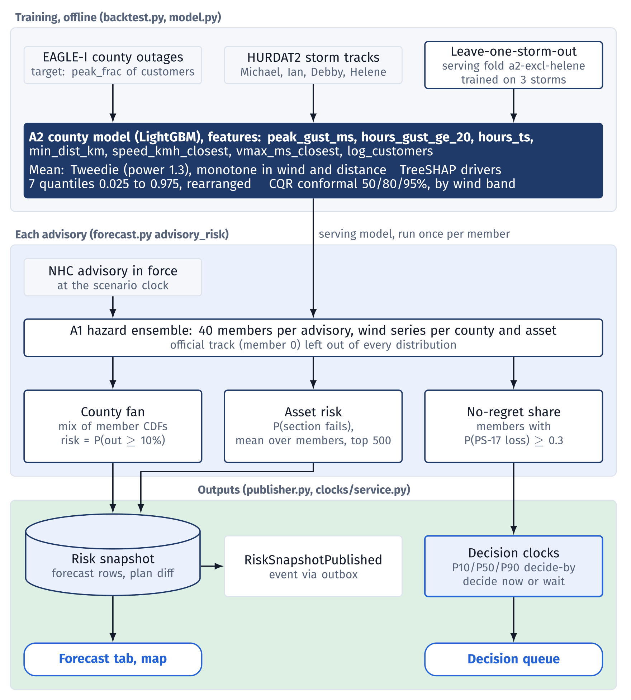
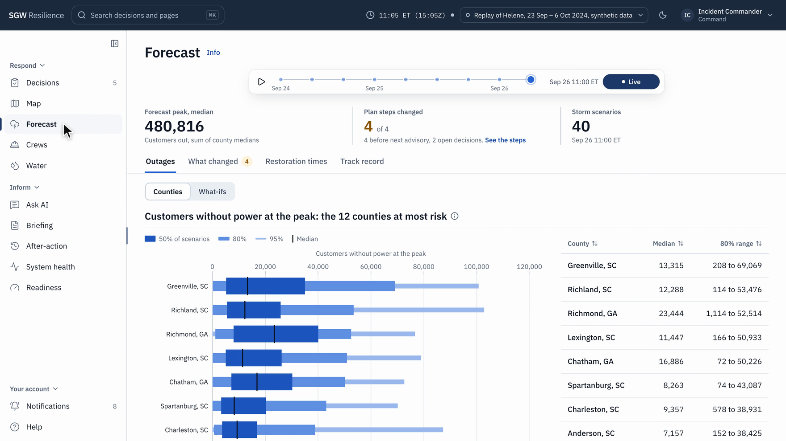

# 06. Outage forecast

The outage forecast estimates how many customers each county will lose at the storm's peak, with a range. It informs D1 (event type and risk) and D2 (crew pre-positioning). Crews are never sized on the forecast alone, and the forecast does not set any decision deadline by itself.

There are two parts. The **hazard ensemble** turns one hurricane advisory into 40 possible storm tracks. The **county outage model** turns each track's wind into customers out. The spread across tracks and the model's own error together give the range shown on screen.



## How it works

1. **Advisory to tracks** (`src/sgw/generator/forecast.py`, `member_tracks`). Each advisory has an official forecast and 40 ensemble members (`forecast.members` in `data/synthetic/family_a.yaml`). The official forecast is the true track displaced along and across by `z * sigma(L)`, where `sigma(L)` is the NHC cone radius at lead time `L` divided by `sqrt(2 ln 3)`, so two thirds of positions fall inside the cone; its intensity is shifted by `z` times an intensity sigma that grows to its 24-hour value. Each of the 40 members adds its own such draw on top of the official error. `z` follows an AR(1) process over a 12-hour lead grid. Member `m` reuses the same random draw in every advisory, so a change between advisories comes from the forecast, not from new noise.
2. **Tracks to wind per county** (`src/sgw/models/hazard/ensemble.py`). Each member track is joined to the observed track up to the issue time, so a county already hit keeps its observed wind. Hazard features (peak gust, wind duration, distance to track) are computed for every county and decision point.
3. **Wind to customers out, per member** (`src/sgw/models/outage/model.py`). The serving model `a2-excl-helene` (`SERVING_MODEL` in `backtest.py`) is a LightGBM model trained on the real storms except Helene:
   - a mean model with a Tweedie objective (many counties near zero, a heavy upper tail), with monotone constraints: more wind or longer wind never lowers it, a farther track never raises it;
   - quantile models at 2.5, 10, 25, 50, 75, 90 and 97.5% (`ALPHAS`), rearranged so they never cross;
   - conformal ranges (conformalised quantile regression, CQR) with scores from a leave-one-storm-out over the training storms, grouped by wind band, with a pooled fallback when a band has fewer than 30 scores (`MIN_BAND_N`).
4. **Mix the members** (`src/sgw/models/outage/forecast.py`). For each county the 40 member forecasts are averaged as distributions, not as numbers: each member's conformal fan (the ends of its 50, 80 and 95% conformal ranges and its median, 7 points) forms a piecewise-linear CDF, the CDFs are averaged, and the mixture is read back at the same 7 levels (`FAN_LEVELS`). The official forecast (member 0) is left out. The fan therefore carries both the storm's uncertainty and the model's error.
5. **County risk.** The probability shown for a county is `P(share out >= 10%)` under the mixture (`COUNTY_EVENT_FRAC = 0.10`).
6. **Drivers.** For each county the top TreeSHAP contributions of the mean model, averaged over members, explain the number.
7. **Publish** (`src/sgw/models/outage/publisher.py`). On each scenario tick the publisher takes the latest advisory issued at or before that time and writes the risk snapshot, county forecasts and the plan difference against the previous advisory, in one transaction. A screen only sees rows published at or before its scenario time (`read.py`).

The mixture in words: for a county, the forecast probability that the share out is below `x` is the average, over the 40 members, of each member's probability that it is below `x`.

```text
F_county(x) = (1/40) * sum over members m of F_m(x)
risk        = 1 - F_county(0.10)
```

## Inputs and outputs

| Input | Source |
| --- | --- |
| Advisory track and intensity | replay scenario (synthetic advisories built on the real Helene best track) |
| Customers per county | EAGLE-I modelled customers (`MCC.csv`) |
| Training labels | ORNL EAGLE-I county outages of past real storms, NOAA HURDAT2 tracks ([04-data.md](04-data.md)) |

| Output | Shown as |
| --- | --- |
| Customers out per county, median and two ranges | inner range 10 to 90%, outer range 2.5 to 97.5% |
| Probability that a county loses at least 10% of customers | county risk on the map |
| Top drivers per county | the "why" of a county number |

## The headline method and how it was tested

The evaluation of record compares methods on 24 real storms in Georgia and South Carolina (2016 to 2025), by leave-one-storm-out: each storm is forecast by a model fitted without it, on its observed track. The best method is a **two-parameter wind fragility curve**: the share out is a lognormal function of peak gust.

```text
share_out = Phi( ln(gust / median) / beta )
```

`Phi` is the standard normal CDF. `median` and `beta` are chosen on a grid that minimises the absolute error in customers on the training storms (`FittedFragility.fit` in `src/sgw/models/outage/experiment.py`). The comparator is a fitted wind threshold rule: counties with a peak gust above `T` lose share `a`, the others share `b`, with `T`, `a` and `b` fitted on the same storms (`src/sgw/models/outage/baseline.py`).

| Result | Value | Registry key |
| --- | --- | --- |
| Storms where the curve beats the wind rule on county error | 21 of 24 | `eval_outage_storms_won` |
| Median county error against the wind rule | 54% lower | `eval_outage_median_mae_reduction_pct` |
| Same, 2016 and 2017 storms left out | 31% lower | `eval_outage_median_mae_reduction_2018_on_pct` |
| Pre-registered bar met by a statistical or machine-learning model | none | `eval_outage_v3_curve_bar_met`, `eval_outage_v3_ml_bar_met` |
| Share of all observed outages the curve forecasts (pooled) | 41% | `eval_outage_share_forecast_pct` |
| Helene, forecast against observed | 0.4 M against 2.3 M customers | `eval_outage_helene_forecast_m`, `eval_outage_helene_observed_m` |

Richer models were tested against the curve with a plan fixed before any result ([models/outage-v3-preregistration.md](models/outage-v3-preregistration.md)) and did not beat it. The full model card is [models/outage-forecast.md](models/outage-forecast.md).

The replay model `a2-excl-helene` is an older four-storm model (Debby, Ian, Michael and Helene, trained without Helene). On its own four-storm test it beat the wind rule on total error for 3 of 4 storms (`eval_outage_replay_storms_won`), missed 67% of Helene's outages (`eval_outage_helene_miss_pct`), and its inner range held 29% of Helene counties, the outer range 57% (`eval_outage_helene_cover_inner_pct`, `eval_outage_helene_cover_outer_pct`).

## Limits

- **It under-calls large storms.** The best tested method, the fragility curve, forecasts about one sixth of Helene's observed total; the replay model shown on screen misses 67% of it. Read the forecast as a ranking of counties and an early signal, not a count.
- **The replay model is not the best tested method.** It stays until a replacement is validated with its ranges and drivers.
- **Three training storms cannot calibrate a storm unlike them.** Coverage is reported per storm, and Helene's is low.
- **Storm size is not perturbed.** Members move and weaken or strengthen the storm, but radii follow the truth (an assumption in `forecast.py`).

## Where in the code

| File | Function or constant |
| --- | --- |
| `src/sgw/generator/forecast.py` | `member_tracks`, cone-based errors |
| `src/sgw/models/hazard/ensemble.py` | member wind features per county |
| `src/sgw/models/outage/model.py` | LightGBM mean, quantiles, CQR, `ALPHAS`, `MIN_BAND_N` |
| `src/sgw/models/outage/forecast.py` | member mixture, `FAN_LEVELS`, `COUNTY_EVENT_FRAC` |
| `src/sgw/models/outage/publisher.py`, `read.py` | publish per advisory, read at scenario time |
| `src/sgw/models/outage/experiment.py`, `baseline.py` | fitted fragility curve, wind threshold rule |


