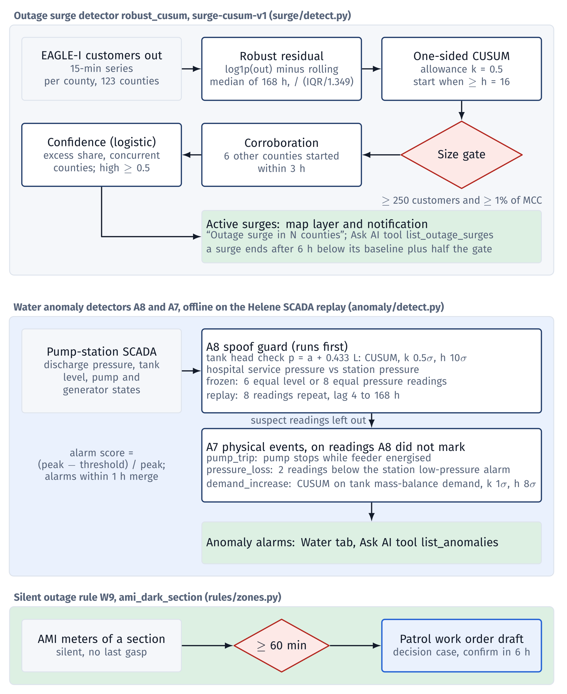

# 07. Surge and anomaly detection

The detectors watch live signals and say when something has started to go wrong: customers out rising in a county, a pump station reading that cannot be true, a pump that tripped, a feed that went quiet. They support situational awareness (D1) and the water decisions (D3), and they tell Ask AI and the operator which data not to trust. No detector signs or sends anything. A detector alarm is shown and read; decisions that follow from it are proposed by code rules and signed by people.

All detectors are plain statistics and rules, with no model trained on the faults themselves. Every detector is causal: the result at time `t` uses data up to `t` only. A replay cut at any scenario time therefore shows exactly what was known then.



## Overview

| Detector | Signal | Statistic and threshold | Confirmation | Where it runs | What it shows |
| --- | --- | --- | --- | --- | --- |
| Outage surge (G1) | 15-min customers out per county (real EAGLE-I) | robust one-sided CUSUM, `k` 0.5, `h` 16 | magnitude gate and 6 other counties within 3 h | `src/sgw/models/surge/read.py`, at the scenario time | surges per county, tool `list_outage_surges` |
| A8 spoof guard | pump-station pressure and tank level (synthetic SCADA) | two-sided CUSUM on a physics residual, `k` 0.5, `h` 10 sigma; frozen and replayed readings | runs of 6 to 8 equal readings; 8-reading repeated window | `src/sgw/models/anomaly/detect.py`, offline on the replay | "suspect sensor" alarms, `/api/anomalies` |
| A7 physical events | same streams, readings A8 did not flag | pump status, low-pressure alarm, tank mass balance CUSUM | 2 consecutive low readings | same | pump trip, pressure loss, demand increase |
| Dark AMI section (W9) | smart meters of a section going silent without "last gasp" messages | code rule after a silence time | rule in `src/sgw/rules/zones.yaml` | `src/sgw/rules/zones.py`, `ami_dark_section` | a patrol work order proposal |
| Feed freshness | time since each source last reported | per-source limit, for example 300 s for OMS, 120 s for electric SCADA | late when known later than 2 times the limit | `src/sgw/pipeline/dq.py` | `dq_check` rows per pipeline run; Ask AI reads feed health with `get_feed_health` |

## Outage surge detector

Question: has the number of customers out in a county started to rise abnormally, and since when?

1. **Residual.** Take `log1p(customers out)` for the county and subtract its rolling median over the previous 7 days (`window_h` 168).
2. **Scale.** Divide by the rolling interquartile range of `log1p(customers out)` divided by 1.349 (a robust standard deviation), floored at 0.35 (`scale_floor`), so a quiet county does not get a tiny scale.
3. **CUSUM.** Add each scaled residual minus the allowance `k` = 0.5 to a running sum that cannot go below zero. A surge can start when the sum reaches `h` = 16.
4. **Magnitude gate.** The excess over the baseline level must be at least 250 customers and 1% of the county's customers (`min_customers`, `min_share`).
5. **Spatial corroboration.** The start counts only when at least 6 other footprint counties started a surge within the last 3 hours (`corroborate`, `corroborate_h`). Storms hit neighbours; equipment faults do not.
6. **Onset and end.** The onset is the slot after the sum was last zero. A surge ends after customers out stay below its baseline level plus half the magnitude gate for 6 hours (`end_h`).
7. **Confidence.** A logistic score on two features at detection, the log of the excess share and the number of other counties surging within 3 hours, gives high (0.5 and above), medium (0.2) or low (`src/sgw/models/surge/confidence.py`).

```text
S_t = max(0, S_(t-1) + r_t - k)       r_t = (log1p(x_t) - median_7d) / max(IQR_7d / 1.349, 0.35)
surge starts when S_t >= 16, the gate passes and >= 6 other counties started in the last 3 h
```

Settings come from `data/artefacts/surge/params.json` (`surge-cusum-v1`), chosen on the 2016 to 2021 seasons only. A 15-min slot counts as known once its collection run has ended (slot start plus 15 minutes at or before the scenario time).

Measured on the test seasons 2022 to 2025 (`evals/reports/outage_surge.json`):

| Result | Value | Registry key |
| --- | --- | --- |
| Recall of NCEI wind episodes, model | 0.479 | `eval_surge_test_recall` |
| Recall, tuned fixed share and rolling z baselines | 0.258 and 0.315 | `eval_surge_test_recall_fixed_share`, `eval_surge_test_recall_rolling_z` |
| False alarms per county-month, model against the baselines | 0.41 against 0.35 and 0.37 | `eval_surge_test_fa_per_county_month`, `eval_surge_test_fa_fixed_share`, `eval_surge_test_fa_rolling_z` |
| Fixed share with the model's corroboration (ablation) | 0.436 | `eval_surge_test_recall_neighbour_ablation` |
| Helene: counties surging by 27 Sep 10:00 ET | 121 of 123 | `eval_surge_helene_counties` |
| Helene: tropical county episodes detected | 0.81 | `eval_surge_helene_tropical_recall` |

The model finds more storm episodes but also raises more false alarms than the baselines, so it does not pass its pre-registered rule. Most of the gain comes from the spatial corroboration. Details: [models/outage-surge.md](models/outage-surge.md).

## Water anomaly detectors (A8, then A7)

A8 runs first and decides whether a reading can be trusted. A7 looks for physical events only on readings A8 left alone. Settings are in `src/sgw/models/anomaly/detector.yaml` and follow from the sensor noise and a target false-alarm rate, not from the faults.

**A8 spoof guard:**

- `pressure_level_inconsistent`: discharge pressure must equal the tank head, `p = a + 0.433 L` (psi from feet of water). A two-sided CUSUM on the standardised residual alarms at 10 sigma with allowance 0.5.
- `service_pressure_inconsistent`: the hospital service pressure must sit a fixed offset below the station pressure.
- `frozen_reading`: 6 equal level readings or 8 equal pressure readings, where noise makes ties rare. An empty tank reading 0 is not flagged.
- `replayed_sequence`: a window of 8 readings that exactly repeats an earlier window 4 to 168 hours back.

**A7 physical events:**

- `pump_trip`: the pump stops while its feeder is energised and no generator change explains it.
- `pressure_loss`: 2 consecutive 15-min readings below the station low-pressure alarm, with the likely cause (power loss, generator failure, pump trip, demand above supply).
- `demand_increase`: tank mass balance in refill or drain windows gives zone demand; a one-sided CUSUM (`k` 1.0, `h` 8) on its ratio to the station's own baseline (first 8 windows) flags a leak or main break that pressure cannot show while the tank is full.

Alarms closer than one hour form one episode. The detectors run offline on the Helene replay (`uv run sgw water anomaly`), and the API serves the alarms detected at or before the scenario time (`src/sgw/api/readmodels/anomalies.py`).

| Result | Value | Source |
| --- | --- | --- |
| Synthetic test set: seeded faults | 115 | `eval_anomaly_dev_faults` |
| Recall, A7 and A8 together | 0.713 (82 of 115) | `eval_anomaly_recall_dev` |
| Recall, low-pressure alarm alone (baseline) | 0.148 | `eval_anomaly_baseline_recall_dev` |
| External check on real SCADA (BATADAL), score S | 0.75 against 0.79 for static limits | `eval_batadal_family_score`, `eval_batadal_limits_score` |

**The external check is negative.** On BATADAL, a public water SCADA benchmark, the same family alarms almost all the time. Its threshold assumes white noise, and real hourly readings are autocorrelated and quantised. The good synthetic result says the detectors work on the twin they were built for, not on real SCADA. See the last section of [models/outage-surge.md](models/outage-surge.md).

## What a detector does not do

- It does not move a decision deadline. Deadlines come from the decision clocks (`src/sgw/models/clocks/`), which change when a new advisory arrives.
- Decisions that follow a detected condition, such as a boil-water notice after pressure falls below the state floor, come from code rules in `src/sgw/rules/` ([09-water-network-model-and-what-if.md](09-water-network-model-and-what-if.md)).

## Limits

- Surge labels (NCEI Storm Events) are incomplete, so precision and false alarms are bounds.
- Surge settings are fitted on Georgia and South Carolina EAGLE-I counts; another utility needs a refit on its own outage counts.
- The water detectors are tested on synthetic faults only, and fail the one real benchmark tried.
- The confidence score ranks surges; it is not the probability that a storm caused them.

## Where in the code

| File | Function or setting |
| --- | --- |
| `src/sgw/models/surge/detect.py` | `robust_cusum`, baselines `fixed_share`, `rolling_z` |
| `src/sgw/models/surge/read.py` | `list_outage_surges(as_of)` |
| `src/sgw/models/surge/confidence.py` | logistic confidence |
| `src/sgw/models/surge/asset.py` | pipeline asset `surge.outages` with data-quality checks |
| `src/sgw/models/anomaly/detect.py`, `detector.yaml` | A8 and A7 detectors, settings |
| `src/sgw/models/anomaly/batadal.py` | external BATADAL check |
| `src/sgw/rules/zones.py` | `ami_dark_section` |
| `src/sgw/pipeline/dq.py` | `FRESHNESS_LIMIT_S`, `late_check` |
