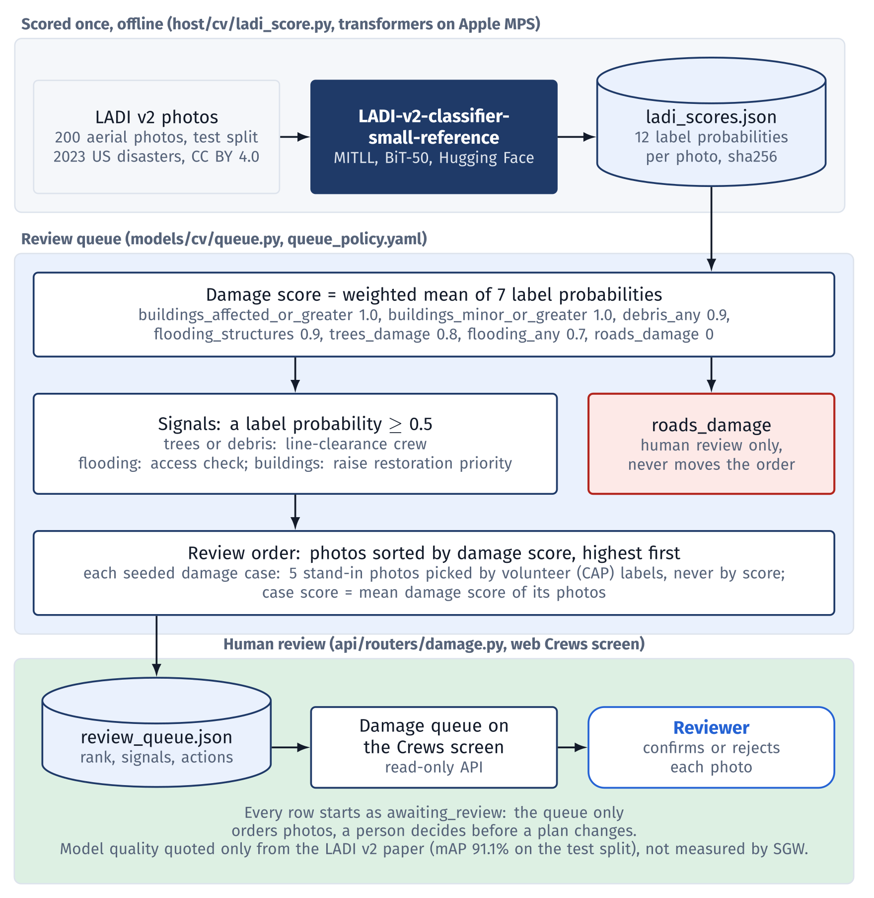
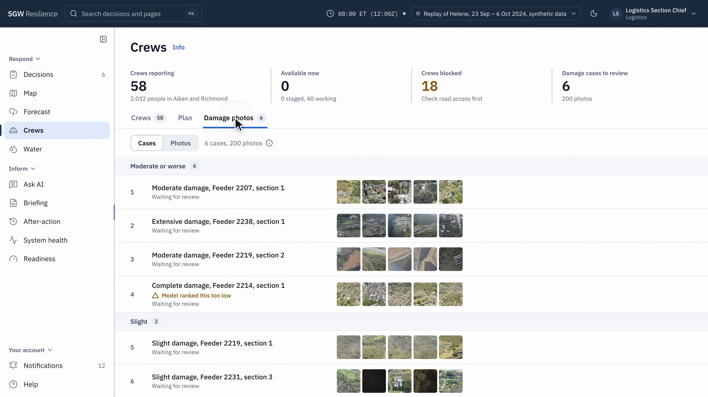

# 08. Computer vision: damage photo triage

After landfall, field teams and aerial flights send far more photos than reviewers can open at once. The damage photo queue puts the photos most likely to show damage first, with the labels the model saw and a suggested follow-up. It supports restoration ordering and crew dispatch (D2, D7) only as a prioritisation aid: a person reviews every photo before it changes a plan, and the model never confirms damage on its own (`review_note` in `data/artefacts/cv/review_queue.json`).



## The model and the photos

| Item | Value | Source in the repo |
| --- | --- | --- |
| Model | `MITLL/LADI-v2-classifier-small-reference`, revision `6ba5a030...`, by MIT Lincoln Laboratory, fine-tuned from `google/bit-50` (BiT-50) | `host/cv/ladi_score.py`, `data/ATTRIBUTION.md` |
| Model licence | MIT (base model Apache-2.0) | `data/ATTRIBUTION.md` |
| Paper | Scheele, Picchione, Liu, LADI v2, arXiv:2406.02780 (2024) | `REFERENCE_MAP` in `src/sgw/models/cv/queue.py` |
| Photos | 200 images sampled from the `MITLL/LADI-v2-dataset` test split: Civil Air Patrol aerial photos of 2023 US disasters, labelled by CAP volunteers | `data/artefacts/cv/sample.json` |
| Photo licence | CC BY 4.0, credited per image in `data/artefacts/cv/thumbs/PROVENANCE.csv` | `data/ATTRIBUTION.md` |

The photos are benchmark imagery, not SGW territory. The repository holds 240 px thumbnails; `uv run sgw photos` downloads the full-size files to a git-ignored folder and checks each one against its recorded sha256 (`src/sgw/models/cv/images.py`).

**Labels.** The model is multi-label: it gives an independent probability (a sigmoid per label) for each of 12 labels: `bridges_any`, `buildings_any`, `buildings_affected_or_greater`, `buildings_minor_or_greater`, `debris_any`, `flooding_any`, `flooding_structures`, `roads_any`, `roads_damage`, `trees_any`, `trees_damage`, `water_any`.

## How scores become a review order

1. **Score offline.** `host/cv/ladi_score.py` runs the model once on the host (Hugging Face `transformers`, `AutoModelForImageClassification`, `torch.sigmoid` on the logits) and writes `data/artefacts/cv/ladi_scores.json`. The platform runs no neural network at run time ("No torch at run time", `queue.py`).
2. **Triage score.** A weighted mean of the damage-label probabilities, with weights from the SGW policy file `src/sgw/models/cv/queue_policy.yaml` (`triage_score`):

   | Label | Weight |
   | --- | --- |
   | `buildings_affected_or_greater`, `buildings_minor_or_greater` | 1.0 |
   | `debris_any`, `flooding_structures` | 0.9 |
   | `trees_damage` | 0.8 |
   | `flooding_any` | 0.7 |
   | `roads_damage` | 0.0 |

   ```text
   triage_score = sum(weight_label * p_label) / sum(weight_label)
   ```

   Road damage has weight 0 because the model's precision for it is weak: it is flagged for human review only and never moves the order.
3. **Signals and actions.** A damage label (one of the seven weighted labels above, `roads_damage` included) with probability 0.5 or more shows as a signal on the row (`signal_threshold`). Each signal maps to a suggested action: trees or debris to a line-clearance crew, flooding to an access check, building damage to a higher restoration priority.
4. **Order.** Photos are sorted by triage score, highest first (`build_queue`). Every row starts as `awaiting_review`.
5. **Damage cases.** The Helene world has seeded damage cases (synthetic). Each gets a set of 5 stand-in photos chosen by the CAP volunteer labels only, never by model score. A case's score is the mean triage score of its photos, and cases are ordered by it (`case_queue`).

The weights, threshold and actions are SGW policy assumptions, not fitted values.

## What a human does

The reviewer opens the queue on the Crews page, looks at each photo at full size with its signals and suggested actions, and decides what it means for the restoration plan. The queue API is read-only (`src/sgw/api/routers/damage.py`, GET routes only). Any change to the plan goes through a normal decision proposal and sign-off ([02-roles-and-decision-workflow.md](02-roles-and-decision-workflow.md)).

## Measured results

| Result | Value | Source |
| --- | --- | --- |
| Mean average precision over the 12 labels, LADI v2 test split | 91.1 (n 1,049 images) | `eval_cv_map_test`, `eval_cv_test_n`, `evals/reports/ladi_reference.json` |
| Same, validation split | 93.3 (n 890) | `eval_cv_map_val` |
| Seeded cases: structural damage (moderate or worse) above every no-damage control group | yes (lowest structural case 0.195, highest control 0.125) | `seeded_order` in `review_queue.json` |
| Severity order of seeded cases | 4 of 13 case pairs out of order; the most severe case ranks 4th of 4 damaged cases | `seeded_order`, `honest_miss` in `review_queue.json` |

The mAP figures are **published by the model authors, not measured by SGW**, and the mean includes easy non-damage labels such as `water_any` (registry caveat of `eval_cv_map_test`). The seeded-case checks use stand-in photos and synthetic cases, so they show the queue logic works, not field accuracy.

## Limits

- The model separates building-damage levels poorly; the paper merged them, so the queue holds only two tiers (moderate or worse, and the rest).
- The photos are from other 2023 events and from the air, not SGW line photos.
- No measured accuracy on SGW imagery exists. A Stage 1 step would score the model on the utility's own labelled photos.

## Where in the code

| File | What it does |
| --- | --- |
| `host/cv/ladi_score.py` | runs the model on the host, writes scores and thumbnails |
| `host/cv/ladi_fetch.py` | downloads the sampled photos |
| `src/sgw/models/cv/queue.py` | `triage_score`, `signals`, `build_queue`, `case_queue`, `REFERENCE_MAP` |
| `src/sgw/models/cv/queue_policy.yaml` | weights, threshold, actions, seeded case profiles |
| `src/sgw/models/cv/read.py`, `images.py` | serve the queue, thumbnails and checked full-size images |
| `src/sgw/api/routers/damage.py` | read-only API routes |


