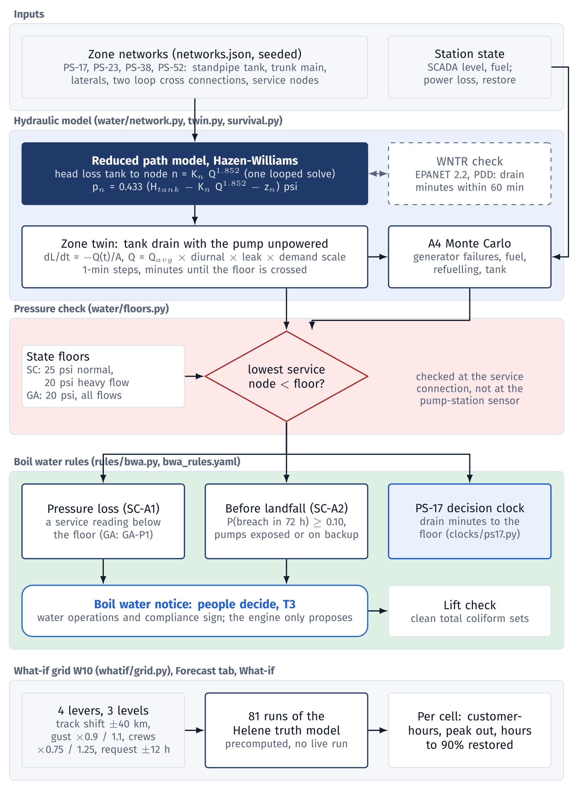
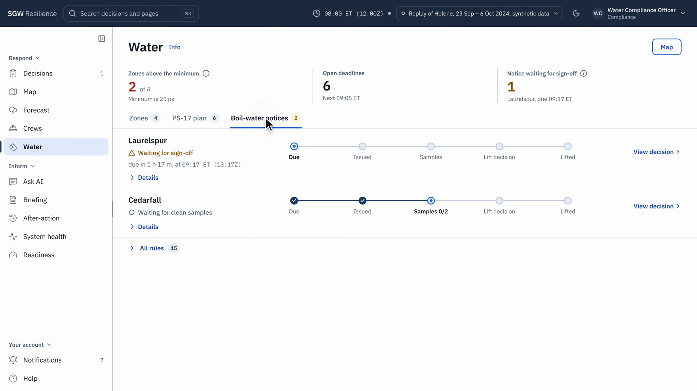
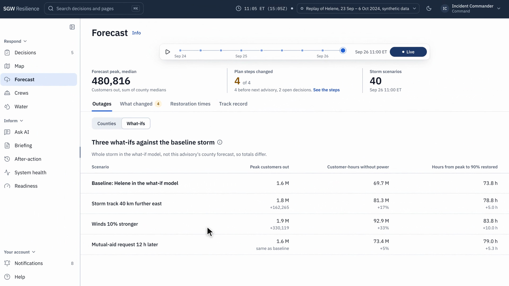

# 09. Water network model and what-if

The water twin answers one question for each pump station: if the pump loses power, how long until the pressure at the most critical customer connection falls below the state floor? That time is the consequence behind the water decisions (D3): generator hookup, fuel delivery, hospital supply, and when a boil-water notice is due. The boil-water rules then turn pressure readings and lab samples into notice proposals and lift checks. Issuing, lifting and wording a notice stay human decisions, signed by Water Operations and Compliance (`src/sgw/rules/bwa.py`).

The what-if grid at the end of this page is a separate, precomputed view of the electric side: how the storm totals change if the track, wind or mutual aid were different.



## The zone network

Each pump station has a small seeded network (`src/sgw/models/water/network.py`, stored in `data/artefacts/water_twin/networks.json`): a standpipe tank beside the station, a trunk main, branch laterals, two loop-closing cross connections and lumped service nodes. The Cedarfall zone has a hospital node. These are synthetic networks, not a real utility's pipes.

Two models read the same file:

| Model | Library | Where it runs | Use |
| --- | --- | --- | --- |
| Full hydraulic model | WNTR (EPANET 2.2, pressure-dependent demand, looped network) | on the host, as a precompute grid (`host/water_twin/`) | checks the reduced model |
| Reduced twin | NumPy, own code | in the platform, for every ensemble member | drain time to the floor |

**Why the reduction is exact enough.** All service nodes follow one demand pattern, and Hazen-Williams head loss is `h = r q^1.852`. One looped steady solve at a reference demand gives, for each node `n`, a coefficient `K_n` so that head loss from the tank to `n` is `K_n Q^1.852` at any zone demand `Q`. The node pressure is then:

```text
p_n = 0.433 * (H_tank - K_n * Q^1.852 - z_n)    psi, heads and elevation z_n in feet
```

## How the drain time is computed

1. **Tank drain** (`src/sgw/models/water/twin.py`). With the pump unpowered, the tank level falls as `dL/dt = -Q(t) / A`, where `Q(t)` is average demand times a diurnal pattern by local hour times a storm leak multiplier. The model steps once per minute and interpolates the crossing inside the step.
2. **Floor at the service connection.** The floor is crossed when the lowest service-node pressure falls below the state floor (`src/sgw/models/water/floors.py`): South Carolina 25 psi in normal operation and 20 psi during heavy flows (S.C. Code Regs. R.61-58.7.E(7)); Georgia 20 psi under all flow conditions (GA 391-3-5-.10). The floor is checked at the customer connection, not at the station sensor, because that is where the regulation applies. The connection sits lower in pressure, so the clock is earlier.
3. **Station continuity Monte Carlo** (`src/sgw/models/water/survival.py`). Per sample and minute: grid power until loss and after restore; a generator that may fail to start (Bernoulli by maintenance class) or fail while running (exponential by class); fuel burn `c * kW * (0.25 + 0.75 LF)` gallons per hour; a refuel request at a trigger level that arrives after the truck lead and a road delay, or a contract delay when the route is blocked; tank volume between empty and full. The result is the first floor breach time and its cause, with a probability over the samples.
4. **Per ensemble member** (`src/sgw/models/water/ps17_members.py`). For PS-17 the drain time is computed for each hazard ensemble member, from the tank level observed at the advisory issue time, the member's exposure time and a demand multiplier per member (Latin-hypercube strata with common random numbers, so a change between advisories reflects the forecast only). These feed the decision clock for the PS-17 generator and fuel decisions (`src/sgw/models/clocks/ps17.py`).

## Boil-water notice logic

The rules engine (`src/sgw/rules/bwa.py`, clauses in `bwa_rules.yaml`) proposes and checks; it never issues. Each result names the clause and the SGW procedure section in force at the decision time.

| Rule | Trigger or condition | Function |
| --- | --- | --- |
| Pressure loss | a reading at a service connection below the state floor; a pump-station sensor alone never triggers it | `pressure_hits` |
| SC pre-landfall advisory | SC zone exposed or on backup power, with a probability of a floor breach within 72 h of at least 0.10; due at landfall | `pre_landfall_hit`, `floors.pre_landfall_advisory` |
| Positive sample | a confirmed positive coliform sample | `positive_sample_hit` |
| Lift (rescission) | SC: flushing after pressure is restored, then coliform-free samples; after positive samples, two clean sample sets at least 24 h apart; in both cases all total coliform results negative and SCDES agreement. GA: mains flushed, samples taken after the wait, enough samples (the number the inspector accepts, 15 to 20) or at least half of the coliform sites, all negative, and EPD concurrence | `lift_check` |
| Notice tasks and draft | regulator notice, written copy and release deadlines, notice text from a template | `lifecycle_tasks`, `notice_template` |

In the Helene world, `src/sgw/rules/zones.py` turns these hits into decision proposals: a boil-water advisory for each zone whose pressure falls below the floor, and its lift once the required clean coliform sets are reported. The lift still needs the regulator's concurrence, which the Compliance signature attests.

The 0.10 breach probability and 72 h horizon are SGW policy assumptions (`src/sgw/models/water/water_twin.yaml`, registry `policy_water_continuity_horizon_h`). The psi floors come from the registry (`sc_pressure_floor_psi`, `sc_pressure_floor_heavy_flow_psi`, `ga_pressure_floor_psi`); the twin never hard-codes a psi.



## Measured results

The check is a **verification of the reduction, not a validation** against a real zone (`kind` in `data/artefacts/water_twin/validation.json`).

| Result | Value | Source |
| --- | --- | --- |
| WNTR runs in the precompute grid | 2,304 | `eval_water_wntr_runs` |
| Reduced twin against WNTR, drain time to the 20 psi floor, median absolute difference | 0.003 min (largest 0.46 min) | `validation.json`, `floors.20_psi.variants.twin_looped` |
| Floor read at the station sensor instead, median absolute difference | 14.5 min | same file, `station_sensor_floor` |
| Pass | yes, tolerance 60 min median | `passed`, `tolerance_median_abs_min` |

The structural band in the same file perturbs pipe roughness and node elevations: the drain time then moves by about minus 15 to plus 8 minutes per station. That shows how much the answer depends on the assumed network.

## What-if grid

A precomputed grid on the synthetic Helene truth model (`src/sgw/models/whatif/grid.py`, `helene_grid.json`). Four levers, three levels each, 81 cells, each one deterministic run:

| Lever | Levels |
| --- | --- |
| Track shift east (+) or west (-) | -40, 0, +40 km |
| Gust scale (times the WMO gust factor 1.49) | 0.9, 1.0, 1.1 |
| Mutual-aid crews (times 13.3 personnel per 1,000 outages) | 0.75, 1.0, 1.25 |
| Mutual-aid request time | 12 h earlier, on time, 12 h later |

Each cell reports footprint customer-hours out, peak customers out and hours from the peak to 90% restored. The Forecast screen's What-if tab compares the baseline with three named cells: track 40 km east, winds 10% stronger and the mutual-aid request 12 h later (`src/sgw/models/whatif/read.py`). Nothing is simulated live. An earlier request is also a smaller one, because mutual aid is sized on the outages known at the request.



## Limits

- The networks are synthetic and seeded. The WNTR check proves the reduction, not that the networks look like SGW's.
- The twin assumes one tank per zone, the pump off for the whole drain, demand fully served, and no transfer between zones.
- The what-if grid is on the synthetic truth model, so its numbers are illustrations, not forecasts.

## Where in the code

| File | What it does |
| --- | --- |
| `src/sgw/models/water/network.py` | zone networks, `K_n` path model |
| `src/sgw/models/water/twin.py` | tank drain to the floor |
| `src/sgw/models/water/floors.py` | state floors, SC pre-landfall rule |
| `src/sgw/models/water/survival.py` | generator, fuel and tank Monte Carlo |
| `src/sgw/models/water/ps17_members.py` | drain time per ensemble member |
| `src/sgw/models/water/validate.py` | comparison with the WNTR grid |
| `src/sgw/rules/bwa.py`, `bwa_rules.yaml` | boil-water triggers, lift checks, notice tasks |
| `src/sgw/rules/zones.py` | proposals raised in the Helene world |
| `src/sgw/models/whatif/grid.py`, `read.py` | what-if grid |
