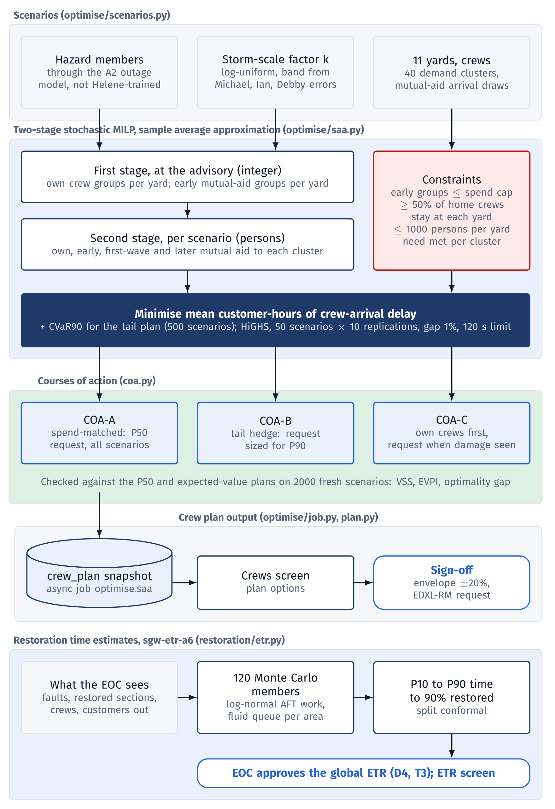
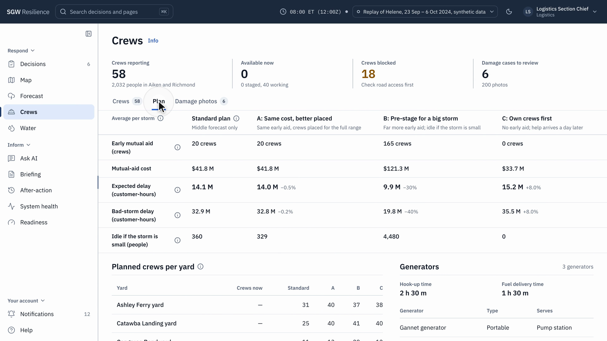

# 10. Crew optimisation and restoration estimates

Two models support the crew decisions. The **crew optimiser** proposes where to stage own crews and how much mutual aid to request before landfall (D2), as three courses of action with their trade-offs. The **restoration estimate (ETR)** says when 90% of the customers out at the peak will have power again, for the whole footprint and per operating area (D4). Both only propose: a person picks a course of action and signs the ETR before it is published ([02-roles-and-decision-workflow.md](02-roles-and-decision-workflow.md)).



## Crew optimiser

### How it works

1. **Scenarios** (`src/sgw/models/optimise/scenarios.py`). One scenario is one hazard ensemble member passed through the outage model ([06-outage-forecast.md](06-outage-forecast.md)), times a storm-scale factor `k`, plus random mutual-aid arrival times. `k` is drawn log-uniform over a band whose half-width is the largest forecast error on the storms other than the one being replayed. Using Helene's own error to plan Helene would be leakage.
2. **Crew need per cluster.** Persons needed = sum over the cluster's counties of `min(1, k * forecast share out) * customers * personnel per 1,000 outages / 1,000`.
3. **Delays.** Crews cannot leave a yard while gusts there are at least 20 m/s; a blocked access road adds the expected debris clearance time; travel is great-circle distance at convoy speed; mutual aid requested now arrives after a random delay, and aid requested after landfall arrives later.
4. **Two-stage stochastic model** (`src/sgw/models/optimise/saa.py`). It is a mixed-integer program solved with the HiGHS solver (`highspy`):
   - first stage, decided now (integers): own crew groups staged at each yard, and mutual-aid groups requested now for each yard;
   - second stage, per scenario (continuous): how many persons go from each yard to each cluster, plus first-wave and later mutual aid after landfall, so that every cluster's need is covered.
5. **Objective.** The cost of a unit of work is the customers it serves times the hours until it starts. The model minimises the mean customer-hours of crew-arrival delay over the scenarios. The tail-hedge plan (COA-B) sizes its early request for the P90 scenario and places it by mean plus the CVaR of the worst 10% of scenarios (Rockafellar-Uryasev form, weight 1.0, `policy_saa_cvar_alpha`, `policy_saa_cvar_weight`), solved on 500 scenarios; that placement is kept only because it beats the risk-neutral placement on out-of-sample CVaR. A small cost per early group keeps the model from requesting crews that save nothing.
6. **Constraints.** Own groups staged are at most the groups SGW has; each yard keeps at least half its home crews (`home_share_min` 0.5); each yard holds at most 1,000 persons (`site_cap_persons`); the early request stays within the course of action's spend cap.
7. **Sample average approximation (SAA).** Each risk-neutral solve uses 50 scenarios, repeated over 10 independent samples; the CVaR solve uses 500. Plans are then scored on 2,000 fresh scenarios (`src/sgw/models/optimise/saa_params.yaml`).
8. **Async job** (`job.py`). A worker claims the job row, solves outside any transaction and stores the plan as a `crew_plan` snapshot. The API reads it (`read.py`).

```text
minimise  mean_s CH_s  [+ 1.0 * CVaR_0.9(CH)]  + small cost per early group
CVaR_0.9 = eta + 1 / (0.1 * S) * sum_s max(0, CH_s - eta)
```

### The courses of action

| Plan | What it commits before landfall | Trade-off |
| --- | --- | --- |
| P50 plan | the deterministic plan for the median scenario (baseline) | cheapest planning view, no hedge |
| COA-A "Spend-matched" | exactly the P50 plan's early mutual-aid request, placed for the whole scenario set | no extra money, better placement; still short in a bigger storm |
| COA-B "Tail hedge" | an early request sized for the P90 scenario | much more committed spend and idle crews in small storms, fewer customer-hours in Helene-scale storms |
| COA-C "Own crews, request later" | no early mutual aid | no early spend, but the most customer-hours |

Each plan also produces a mutual-aid request in the shape of an OASIS EDXL-RM `RequestResource` message (`edxl.py`). It never includes asset risk rankings.

### Measured results

On the synthetic Helene replay (`evals/reports/saa.json`):

| Result | Value | Registry key |
| --- | --- | --- |
| Value of the stochastic solution: COA-A against the P50 plan | 63,435 customer-hours saved (95% interval 55,036 to 71,834) | `eval_saa_vss_customer_hours`, `eval_saa_vss_ci_low`, `eval_saa_vss_ci_high` |
| Out-of-sample scenarios | 2,000 | `eval_saa_scenarios` |
| Upper bound on the optimality gap | 0.07% | `eval_saa_gap_upper_pct` |
| Expected delay, median plan against tail hedge | 14.09 against 9.87 million customer-hours | `eval_saa_median_plan_delay_mch`, `eval_saa_tail_hedge_delay_mch` |
| Expected mutual-aid cost, median plan against tail hedge | 41.8 against 121.3 million USD | `eval_saa_median_plan_aid_musd`, `eval_saa_tail_hedge_aid_musd` |

The optimality gap uses the paired Mak-Morton-Wood estimator over the 10 samples, with a one-sided 95% bound (`coa.py`).



## Restoration estimate (ETR)

### How it works

1. **What the model sees** (`src/sgw/models/restoration/etr.py`). At the issue time it sees what an emergency operations centre sees: faults so far, sections restored or in progress, damage states of assessed sections, the crew roster and mutual aid arrived so far, and customers out up to now. It does not see unassessed damage, hidden secondary jobs or future arrivals.
2. **Job work model** (`aft.py`). Work per job is log-normal with right censoring (an accelerated failure time model). A storm-level productivity effect is updated from this storm's finished and in-progress jobs.

   ```text
   log W_i = x_i' beta + rho_storm + sigma_g * eps_i,   eps ~ N(0, 1)
   ```

3. **Monte Carlo.** Each of 120 members (`params.yaml`) draws the unseen parts: damage states given the gust, secondary jobs (transformers, service drops), access clearance and mutual-aid delay. It then schedules the remaining work per operating area as a queue on the area's crew capacity, in dispatch-priority order, with crews working 16 hours on and 8 off.
4. **Range.** The P10 to P90 of the members is calibrated by split conformal prediction on log hours (`conformal.py`): on one half of the calibration storms all quantiles are shifted by the median error of the P50; on the other half the interval is widened or narrowed until it holds the nominal share.

The estimate is scored against a restoration process (`process.py`) calibrated to Helene EAGLE-I county restoration times (`calibrate.py`), so the test storms are synthetic.

### Measured results

Test storms of the synthetic family, issued at the declared peak (`evals/reports/etr.json`):

| Result | Value | Registry key |
| --- | --- | --- |
| Test storms | 60 | `eval_etr_test_storms` |
| Median error of the global P50 | 8.2%, against 17.1% for a historical analog (area peak plus the Helene county median) | `eval_etr_global_error_pct`, `eval_etr_global_analog_error_pct` |
| Share of true times inside the 80% range, global | 88% (58% before calibration) | `eval_etr_cover_global_pct` |
| Same, per operating area | 81% | `eval_etr_cover_regional_pct` |
| Helene story, per-area error of the P50 | 4.3 h against 29.8 h for the analog, 11 areas | `eval_etr_story_area_error_h`, `eval_etr_story_area_analog_error_h`, `eval_etr_story_areas` |

## Limits

- Both models run on synthetic SGW crews, yards and restoration jobs. The crew need uses a public Helene ratio of personnel per 1,000 outages.
- The optimiser inherits the outage forecast's under-call; the storm-scale band widens the scenarios but does not correct the bias.
- ETR results are on synthetic test storms from the same process family; real accuracy is unknown until it is scored on a utility's own outage records.
- Policy values (home share, site cap, CVaR weight) are SGW assumptions.

## Where in the code

| File | What it does |
| --- | --- |
| `src/sgw/models/optimise/scenarios.py` | SAA scenarios, storm-scale band, delays |
| `src/sgw/models/optimise/saa.py` | two-stage MILP in HiGHS, CVaR |
| `src/sgw/models/optimise/coa.py` | courses of action, VSS, EVPI, optimality gap |
| `src/sgw/models/optimise/job.py`, `read.py`, `edxl.py` | async job, API read, mutual-aid request |
| `src/sgw/models/restoration/etr.py` | ETR Monte Carlo |
| `src/sgw/models/restoration/aft.py`, `conformal.py` | job work model, interval calibration |
| `src/sgw/models/restoration/process.py`, `calibrate.py` | restoration truth process, Helene calibration |
