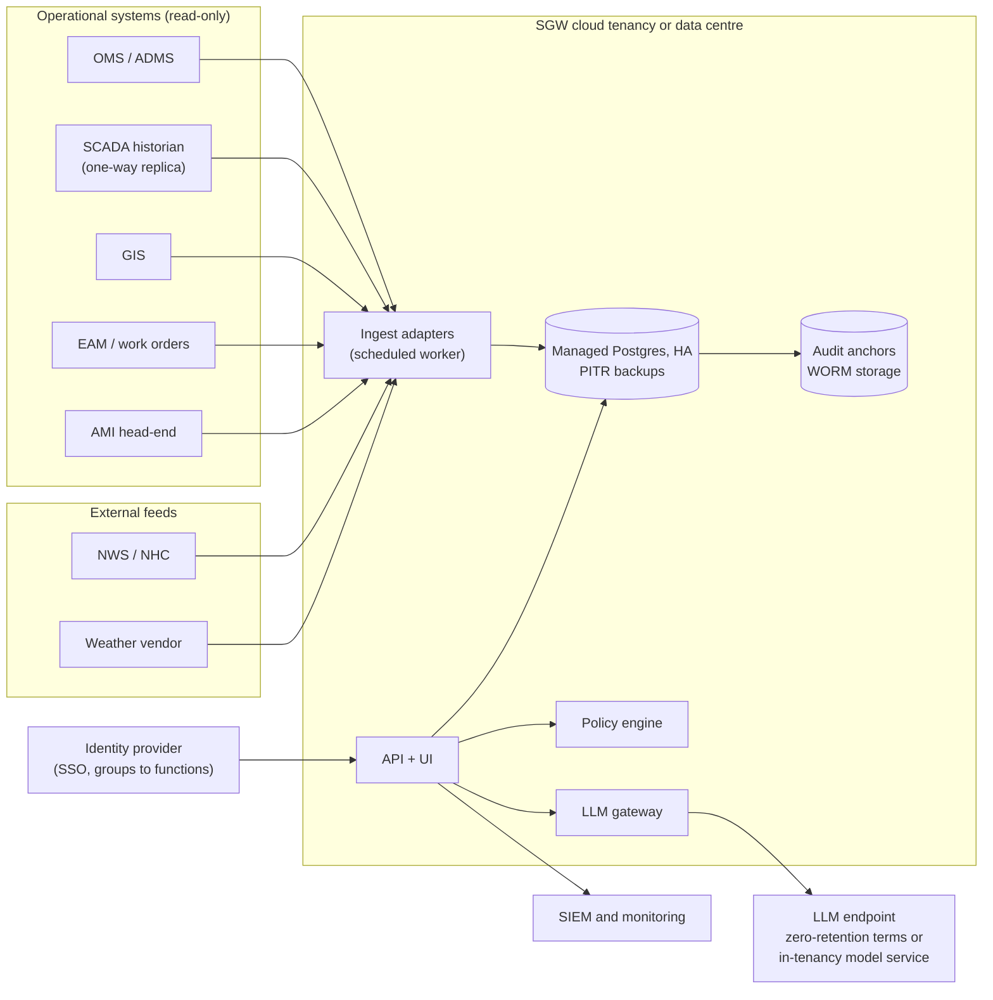

# 12. Assumptions, limitations and improvements

Audience: a reviewer deciding how far to trust what the prototype shows, and what it would take to go further. The task brief left the client context incomplete on purpose; this page lists the assumptions that fill the gaps, what the prototype does not prove, and what would come next. The full limitation register with evidence is [limitation register](12-assumptions-limitations-and-improvements.md#limitation-register); the PRD's "Key assumptions and unknowns" section lists every assumption with its owner and how to validate it ([deliverables/prd.pdf](deliverables/prd.pdf)).

## Key assumptions

Each assumption shapes the design; each would be checked with SGW in the first weeks of a pilot.

| Area | Assumption | What it changes in the design |
| --- | --- | --- |
| Organisation | SGW is an investor-owned holding with an electric utility and a regulated water subsidiary, overseen by the state utility commissions | ROI is shown as utility cash and customer value; water decisions need a compliance signature |
| Territory | South Carolina plus Georgia east of 83.6 W: 123 counties | The footprint of the synthetic network, the map and the county outage data |
| Decision rights | Storms run under the Incident Command System: the Incident Commander approves event type and the global restoration estimate; a certified water operator and the compliance officer own boil-water decisions | The tier table and the two-team pairs ([02](02-roles-and-decision-workflow.md)) |
| Systems of record | GIS, asset management, outage management, SCADA historians, meter data, field service and lab systems exist and offer read access | One adapter interface; replay adapters stand in for them |
| OT boundary | The platform is advisory, outside the control network, with no write path to operational technology | "Execute" records an effect; T4 has no tool |
| Advisory role | Outage management, SCADA and the incident command system stay the systems of record; operations continue without the platform | Degraded modes keep clocks and approvals working without the LLM |
| Data to external AI | Only synthetic or public content reaches an external model in the prototype; production routes follow a data-class table | Egress policy route R1 allows C0 and C1 only ([11](11-security-governance-and-human-oversight.md)) |
| Field input | Field notes, tickets and public alert text are untrusted and never carry authority | Guards, taint marks and the read-only Ask |
| Deadlines | A decide-by clock is an estimate; a missed clock is a learning signal for the after-action review, except where a rule sets the deadline (boil-water notice) | Clocks show P10 to P90 ranges; rule deadlines are labelled as such |
| Approver response | Approvers for two-team decisions can respond within the approval window during a storm | Emergency approval with a 24-hour co-sign exists for when they cannot |
| Retention | Audit records are kept 7 years as SGW policy | Insert-only audit with signed anchors |
| Users | English UI, accessibility to WCAG 2.2 AA, desktop-first use in the operations centre | [DESIGN.md](../DESIGN.md) |
| Results | Model results in the prototype are verification on simulated or replayed data, not evidence of SGW field accuracy | Every figure carries a label ([04](04-data.md)) |

Policy values in the platform (lead times, tier limits, thresholds) are SGW policy assumptions and are shown in the UI as "Assumed SGW policy".

## Limitations

The most important ones, in plain terms. Evidence and the full list: [limitation register](12-assumptions-limitations-and-improvements.md#limitation-register).

| Area | What the prototype does not do or prove |
| --- | --- |
| Data | SGW's network, customers and storm-day events are synthetic. Results on SGW's real assets are unknown. |
| Second scenario | Hurricane Ian is a scripted exercise on the real track, not a modelled replay: Forecast and Water are not modelled for it, Crews is a read-only roster. |
| Outage forecast | It under-calls large storm totals, so crews are never sized on it alone; the Helene replay still shows ranges from an earlier model ([06](06-outage-forecast.md)). |
| Detectors | The outage surge detector failed its pre-registered bar on the held-out 2022-2025 seasons and is shown with that verdict; pressure anomaly recall (0.713, `eval_anomaly_recall_dev`) is below its 0.8 target ([07](07-surge-and-anomaly-detection.md)). |
| Computer vision | Benchmark imagery of 2023 US events, scored by a published classifier that was not fine-tuned ([08](08-computer-vision.md)). |
| Water model | Validated against a hydraulic grid on the same synthetic networks, not a real utility model ([09](09-water-network-model-and-what-if.md)). |
| Crew plans | No real yard capacity data (an assumed cap of 1,000 persons per yard stands in), and straight-line travel at a fixed speed without road closures (blocked access only as an expected debris-clearance delay) ([10](10-crew-optimisation-and-restoration-estimates.md)). |
| Ask AI | Recorded questions replay at no cost; any other question needs a live model call, or gets a shorter answer built by code without a key. Its question bank was written by the development team and is no longer fully blind ([05](05-ask-ai-agent-system.md)). |
| Ask AI, one recorded answer | On the demo moment "11 AM advisory: deadlines move", before any signature, the recorded answer to the starter question prints a raw decision id in brackets, "(DC-D3-PS17-FUEL)", where a decision name should be. The answer recorded after the signatures is clean. |
| Decision graph evaluation | The held-out sets of the decision graphs (including the red-team set) are hash-locked but not yet scored by a release harness. |
| Background jobs | The `worker` container is a placeholder; some loops (commitment watch, optimisation jobs, pipeline runs) start from the CLI. |
| Security | The gateway trusts the declared data class of each payload; approvals are bound to sessions, not per-user signing keys; a revoked session keeps an open stream until the client disconnects; audit rows after the newest checkpoint are protected only by the chain until the next one (at most 60 seconds). |
| Platforms | Measured on macOS with Docker Desktop on Apple silicon; Linux and Windows (WSL 2) paths are written and configured in CI but not run by hand. |

## Improvements

| Next step | What it closes |
| --- | --- |
| Read-only adapters to SGW's own systems behind the existing adapter interface, starting with one operating area and one water system | Synthetic data; unknown behaviour on real assets |
| SGW's own lead times, tier tables and thresholds, reviewed by operations and compliance | "Assumed SGW policy" values |
| Rainfall forecast input and a new pre-registered forecast test on unseen storms | Forecast under-calls on large storms |
| Flow metering in the water model and a run against a utility hydraulic model | Anomaly recall; water model validation |
| SGW imagery from a past storm, labelled by its damage assessors | Benchmark imagery |
| Yard capacities and road travel times with closures | Crew plan realism |
| A release harness that scores the held-out sets once per release, and questions from real users in a pilot | Evaluation gaps |
| Fix the Ask synthesis text for the raw id and re-record that answer | The one recorded answer with a raw id |
| One scheduled worker for ingest, pipelines, commitment watch and optimisation jobs | CLI-started loops |
| SSO from SGW's identity provider, per-user signing keys or the utility's PKI, content detectors for infrastructure identifiers, write-once storage for audit anchors | Security gaps |
| A second modelled storm with its own generated network | Ian as a scripted exercise only |

The smallest architecture for a real pilot, and what it leaves out on purpose, is in [trade-offs](12-assumptions-limitations-and-improvements.md#trade-offs-and-the-minimum-pilot-architecture), "Minimum pilot architecture".

## Limitation register

Audience: a reviewer deciding how far to trust what the prototype shows. Each row says what is limited, why it matters, and how it would be closed. It describes `main` as of 22 November 2026.

### Not built yet

| Item | Effect | How to close |
| --- | --- | --- |
| Background worker | The `worker` container runs a placeholder. The commitment watch, SAA jobs (`uv run sgw optimise work`) and pipeline runs are started from the CLI, not scheduled. Webhook delivery has its own service (`webhooks`), and rule and exercise decisions are raised by the API's scenario-jobs loop. | Wire each loop into the worker service with its own health check. |
| Release evaluation of the decision graphs (`evals/reports/release.json`) | The held-out sets of the decision graphs exist and are hash-locked (`evals/MANIFEST.sha256`), but no harness has scored them; only dev-split and builder-set numbers exist for those graphs. Ask AI has its own scored bank (below). | Evaluation harness package; run `make evals-check` first. |
| A second modelled scenario | Hurricane Ian (2022) is a scripted exercise, not a replay: only its track is real (NOAA HURDAT2 best track; no cone, because no NHC cone archive for Ian is shipped offline). Customers out, facilities, crews and the eleven decisions are scripted and labelled "Scripted exercise data (synthetic)". Forecast and Water show "Not modelled for this scenario"; Crews is a read-only roster without dispatch; After-action has no scorecard or regulator report; Briefing has no forecast toggle, surge line or situation-report draft. Heat wave (July 2024) and Table Rock wildfire weather (March 2025) stay readiness previews on real station data. | Script the Marshgrass Neck water zone, the notice register and the outage curve for Ian; then a second replayed storm with its own synthetic network (scenario packs under `data/scenarios/`). |
| `/v1/events`, secret rotation, delivery log, token list and revoke routes | Built and tested on an app that mounts them, but the served app does not, because the K3 contract does not list them yet. | Add them to K3, regenerate contracts, and the router mounts them. |
| Report graphs on a live gateway | `etr`, `sitrep` and `after_action` run in replay from committed recordings; live text quality was measured on 4 to 13 dev cases per node. (Ask was run live on its question bank, see below.) | More live cases and the held-out sets. |

### Ask AI

| Area | Limitation | Evidence | How to close |
| --- | --- | --- | --- |
| Replay and live | Recorded questions answer at no cost. Any other question needs a live model call: without a key the answer comes from code (same facts and links, shorter text). Recordings are keyed by prompt text, tool results and scenario time, so any change to a tool result needs a re-record. | `docs/gateway.md`, `data/fixtures/llm/` | Keep re-recording in the merge gate; a reviewer key with a spend limit. |
| Question bank | 373 questions written by the development team, graded by code graders; an optional model judge is uncalibrated and never gates. The held-out score (110 of 110 on the final build, 100 of 110 before the last fixes) is no longer blind for 10 questions: the failures of the first final-build run were read to find their root causes, fixed, and the questions those fixes change were asked again and merged by question id; that run's 41 items cut by its spend cap were asked again on the same code, and 36 held-out questions were exposed in an early report that the development team's branch merged before redaction (disclosed rather than replaced). | `data/artefacts/evals/ask_bank/heldout-f8-complete.md`, `evals/ask_bank/README.md` | Questions from real users in a pilot; a fresh held-out set scored once per release. |
| Measures | Ask and Briefing give the same customers-out figure (the county total of the replay). Ask also names the narrower count of open outage events on SGW feeders, as a separate, plainly labelled measure. | `src/sgw/agent/tools/` (`get_outages`) | None intended. |
| Replay timing | A replayed answer waits for the time its live call took when it was recorded (at most 12 s per call in the demo stack, off in tests and evaluations), and the working line names the step that really runs. Answers computed by code alone (deadline lists, "no damage photos yet") make no model call and come back at once. | `services/llm_gateway/api.py`, `web/src/features/ask/StepsLine.tsx` | None intended. |
| Ian exercise in Ask | Ask reads the exercise data (decisions, county customers out, facilities, crews) and says "not modelled for this scenario" for forecasts, risk, water and photos. No Ian answer is recorded: each question is a live call, or a shorter code answer without a key. | `src/sgw/agent/tools/reads.py` | Record the exercise starters. |
| One recorded answer | On the demo moment "11 AM advisory: deadlines move" (`at-n1`), before any signature, the recorded answer to the starter question prints a raw decision id in brackets, "(DC-D3-PS17-FUEL)", where the decision name should be. The answer recorded after the signatures is clean. | review of the recorded clips, 22 November 2026 | Change the synthesis text so it names decisions in words, then re-record that answer. |
| Scope | Read-only by design: Ask cannot approve, sign or dispatch, and says so with a link to the decision. | `src/sgw/agent/route/gate.py` | None intended. |

### Data and models

All SGW data is synthetic, calibrated to public sources ([data.md](04-data.md#dataset-reference)). Numbers in this repository carry a label: F fact, C computed, A assumed, P SGW policy (assumed), S synthetic, U unverified.

| Area | Limitation | Evidence | How to close |
| --- | --- | --- | --- |
| Outage forecast (A2) | The forecast is a two-parameter wind-fragility curve. It beat a fitted wind-threshold rule on county error for 21 of 24 real storms (leave-one-storm-out, observed tracks), and richer statistical and machine-learning models did not beat it in a pre-registered test. It under-calls the storm total on 18 of 24 storms (41% of all observed outages, 30% for the eight largest; Helene 0.4 M against 2.3 M), so crews are never sized on it alone. Wind calibrated on airport gust records narrows the typical total miss from a factor of 2.3 to 1.7, descriptive only. The Helene replay still shows county ranges from the earlier boosted model (trained on three storms), whose inner range held 29% of Helene counties. | [models/outage-forecast.md](models/outage-forecast.md), `evals/reports/outage_loso_v2.json`, `evals/reports/outage_loso_v3.json` | Rainfall forecast input (NOAA WPC QPF) and a new pre-registered test on unseen storms (Stage 1); switch the replay once a replacement is validated with its band and intervals. |
| Hazard features | No inland decay or land roughness: broad, weak storms get too much wind. | hazard check, `uv run sgw models hazard-check` | Add a decay model and roughness from land cover. |
| Restoration and ETR (A6) | Coverage is measured on synthetic storms only; no real crew or job data exists. The process reproduces Helene county medians but not their spread. The replay fixtures still restore with the generator's shorter tail, so the replayed outage curve and the published ETR disagree. | `evals/reports/etr.json` | Hindcast against published utility ETRs; regenerate fixtures with the restoration process. |
| Crew pre-positioning (A5) | No real yard capacity data: an assumed cap of 1,000 persons per yard stands in. Travel is straight-line at a fixed speed without road closures; blocked access counts only as an expected debris-clearance delay. Helene's synthetic truth needs several times the crews of the P50 forecast, outside the planning band, so every plan is mostly late mutual aid there. | `evals/reports/saa.json` | Yard capacities from logistics; road travel times with closures (OSRM or the utility's routing). |
| Water twin (A4) | Validated against a WNTR grid on the same synthetic networks, not on a real Aiken-area zone model. | `data/artefacts/water_twin/validation.json` | Run against a utility EPANET model. |
| Pressure anomaly (A7, A8) | Bench recall below the 0.8 target: leaks while the tank stays full are invisible without flow metering. Detector settings were tuned once on dev data. A pairwise alarm cannot say which sensor is wrong. | `data/artefacts/water_twin/anomaly_dev.json` | Flow meters in the model; score on the held-out family-B faults. |
| Boil-water hinge | The breach probability multiplies P(loss) and P(breach given loss) as independent; at advisory N+1 the result sits close to the policy threshold, so a dependent model could move it either way. | WP-24 rules tests | Joint simulation of power loss and drain. |
| Damage triage (CV) | LADI v2 images of 2023 US events, not SGW territory; scores from the published reference classifier, not fine-tuned. The ranking result depends on five photos per case. | `evals/reports/ladi_reference.json`, `data/artefacts/cv/` | Own imagery from a past SGW storm, labelled by damage assessors. |
| Wildfire and heat triggers | Ignition weights rest on two years of one station; the heat trigger treats observed maximum temperature as a perfect day-ahead forecast. | `src/sgw/models/wildfire/params.yaml`, `src/sgw/models/heat/params.yaml` | More stations and years; forecast skill. |
| Procedure retrieval | The corpus is synthetic; retrieval was measured on development sets only; the reranker was not evaluated because fusion already ranked every builder item. | `uv run sgw rag eval` | Real SOPs under NDA; held-out retrieval set. |
| Exercise injects | The 31 extra decisions and 20 facilities on the Helene timeline, and the whole Ian exercise, are scripted exercise data (synthetic), not raised by models; their deadlines are rule deadlines. A presenter who loads a later moment finds the earlier injects already signed in the exercise script. | `src/sgw/rules/injects.py` | Real exercise injects from SGW's own exercise programme (HSEEP MSEL). |
| Outage surge detector | Failed its pre-registered bar on the held-out 2022-2025 seasons; shown with that verdict, never as beating the baseline. | `evals/reports/outage_surge.json`, [models/outage-surge.md](models/outage-surge.md) | More storms, a new pre-registered test. |
| Determinism across OS | Generator, what-if and ETR golden values were measured on macOS arm64 only; floating-point differences on Linux could change a hash. | golden tests with tolerances | CI on ubuntu compares hashes. |

### Security and operations

| Area | Limitation | How to close |
| --- | --- | --- |
| Data classes to the LLM | The gateway trusts the declared class of each payload; a C3 item labelled C1 passes unless it contains a canary or a secret shape. | Content detectors for infrastructure identifiers; classify at the evidence builder. |
| Login | Login and step-up attempts are limited by in-process token buckets per client address and per user (`src/sgw/api/ratelimit.py`, defaults in `src/sgw/api/settings.py`); the buckets live in one API process and reset when it restarts. Demo mode has a person chooser on the sign-in page and allows short local passwords (`DEMO_PASSWORD_MIN_LENGTH`, never below 3). | A shared limiter; SSO in a pilot. |
| Open streams | A session revoked while its SSE stream is open keeps streaming until the client disconnects. | Re-check the session at each heartbeat (the `/v1/events` stream already re-checks its token). |
| API processes | One uvicorn worker is assumed; a second process's broadcaster may lag and send clients a resync. | Shared broadcaster or sticky sessions. |
| Audit gap | Rows written after the newest checkpoint are protected only by the hash chain until the next checkpoint (every 60 s). | Checkpoint after each critical write (break-glass and kill switch already do). |
| Webhook targets | DNS can change between the address check and the HTTP connect (rebinding). | Resolver-pinned transport. |
| Approver identity | Approvals are bound to sessions, not to per-user signing keys. | Per-user keys or the utility's PKI. |
| Cross-OS | Measured on macOS (Apple silicon, Docker Desktop). Linux and Windows code paths in `sgw doctor` and `sgw bootstrap` are written and covered by the CI matrix configuration, not run by hand; GitHub Actions is not running for this repository, so the gate runs locally (`scripts/check.sh merge`). Images are built for the local architecture; the multi-arch build is described in [ops/multi-arch.md](ops/multi-arch.md). | CI runs on ubuntu, macOS and Windows. |
| Metrics | Admin > System metrics counts requests per API process since it started; streams are counted but not timed. Long-term metrics need the optional `obs` profile. | Send the same counters to the utility's monitoring. |
| Document build | PRD and briefing PDFs need a TeX Live installation; the prose lint does not. | Containerised TeX build. |

## Trade-offs and the minimum pilot architecture

Audience: the technical delivery team and the architects who would take the prototype to a pilot. The first part lists the choices made for the prototype, what each one costs, and when to revisit it. The second part proposes the smallest architecture that could run a real pilot. Both are proposals for discussion, not commitments.

### Prototype trade-offs

| Choice | Gained | Given up | Revisit when |
| --- | --- | --- | --- |
| Decision clocks as the core object | Every screen answers "what must be decided, by when, and why"; the basis is inspectable | Models must emit distributions; cases with too few members reaching the consequence show no clock | Users ask for a plain risk view as the entry point |
| Authority enforced by policy and DB triggers | An agent or a buggy route cannot create an approved action | Rules exist twice (Rego and PL/pgSQL) and need parity tests | The approval model moves into the utility's workflow system |
| LLM explains through slots | No untraceable number reaches an operator; a template path with the same values | Some correct prose is rejected; prompts are part of the replay contract | Verifier rejection rates on held-out sets are known |
| One egress gateway | One place for keys, data classes, budget and audit rows; keyless replay | An extra service; a replay miss falls back to templates | The utility mandates its own AI gateway |
| Postgres only | Runs on one laptop; one store to secure and back up; no dual writes | A single point of failure; ledger throughput bounded by one relay | Sustained ingest beyond what one relay handles, or many independent consumers |
| SSE plus REST | Resumable streams over plain HTTP; writes stay idempotent and auditable | No client-to-server push channel | A field app needs offline sync |
| Replay of a real storm on synthetic SGW data | Repeatable demos and tests; real Helene track and county outages as calibration | Behaviour on SGW's real assets is unknown | Phase 0 data access |
| Precomputed what-if grid (81 cells) instead of live simulation | Instant answers in the demo | Only the four grid dimensions can be varied | Users need other levers |
| Reduced water twin instead of EPANET at run time | Fast enough for every ensemble member | Valid only for one tank per zone with the pump off | The utility shares its hydraulic models |
| Two-stage stochastic optimisation (SAA) for crews | Plans that hedge across forecast members, with the value of the stochastic solution reported | Solve times of seconds to tens of seconds; no road network | Crew routing is in scope |
| Ask AI as a read-only team (router, wide gate, planner, parallel workers, synthesis, guide) instead of one model loop | Answers that combine forecast, grid, water and policy evidence; helpful refusals; deep links built by code | More model calls per question (a few cents live) and more recordings to keep in step | The question bank shows the single loop is as good |
| `replay_then_live` for the demo | Recorded questions cost nothing and never change; new questions still get a real answer | A spend cap and a key file to manage; unrecorded answers vary | A hosted demo needs a shared key |
| Scripted exercise injects on the Helene timeline instead of more generated storms | Every signing role has decisions at each moment within hours of work | Inject numbers are scripted, not modelled, and labelled so | Scenario packs with their own generated worlds |
| Hurricane Ian as a scripted exercise pack on the real track instead of a second generated replay | A second storm every role can work in, within a day of work, without touching the Helene demo | Forecast and Water are not modelled for it; outages, facilities and crews are scripted | A generated Ian world with its own network, run through the same models |
| Replayed Ask answers paced at their recorded duration instead of instantly | The demo shows how long the agent team really takes, with the real step names | A replayed answer is slower than it could be | Instant replay (looked mocked) |
| In-app API metrics instead of starting Prometheus and Grafana from the UI | No privileged helper with Docker rights; nothing to start or stop | Counts reset with the API process; no history | The pilot's monitoring takes the counters |
| Reinforcement learning not used | No simulator-trained policy with unclear failure modes in a safety-relevant loop | Possible gains in sequential dispatch | A validated restoration simulator and years of outcome data exist |

### Minimum pilot architecture

**Scope [A].** One electric operating area and one water system with its pump stations, one hurricane season, read-only integrations, the decision queue for the five storm decisions, and the after-action review. People keep the systems of record; the platform proposes, explains, clocks and records.

| Component | Pilot choice | Change from the prototype |
| --- | --- | --- |
| Hosting | Containers on the utility's existing platform (a managed container service or its Kubernetes, whichever it already runs) | Compose on a laptop becomes a deployment with health checks and rolling updates |
| Database | Managed or Patroni-run Postgres with high availability and point-in-time recovery; the eight extensions verified on the chosen service first | Single instance becomes a replicated pair |
| Identity | SSO (OIDC or SAML) from the utility's identity provider; directory groups map to the ten functions (command, operations, planning, logistics, water_operations, compliance, executive, audit, data, platform) | Demo users and the persona switcher are removed |
| Integrations | Read-only adapters per system behind the existing K6 port: OMS, SCADA historian replica, GIS, EAM, AMI, NWS/NHC, one weather vendor | Replay adapters stay for drills and training |
| OT boundary | No write path; the SCADA feed comes from a historian replica outside the control network | Same rule as the prototype (T4 has no tool) |
| LLM | Through the gateway to a provider endpoint on zero-retention terms, or a model service inside the tenancy; route R2 for C2 data with pseudonymisation | Replay remains for tests |
| Audit | Checkpoint anchors to write-once object storage; chain verification in the nightly job | Local anchor files become WORM storage |
| Operations | The `obs` profile's metrics feed the utility's monitoring; security events to its SIEM; kill-switch drills each quarter | Same kill switch and degraded modes |
| Background jobs | One scheduled worker for ingest, pipelines, commitment watch, webhooks and optimisation jobs | Replaces the CLI-started loops |

**Explicitly not in the pilot [A].** A log broker such as Kafka (Postgres handles one area's event rate; revisit when several regions or many consumers share the ledger), a field mobile app, public notice sending (drafts only), crew routing, multi-region deployment, and model retraining pipelines beyond the scheduled backtests.

**Entry conditions [A].** Data-sharing agreement and read access to the five systems; the utility's lead-time values and approval tiers reviewed by operations and compliance (every policy value in the prototype is labelled "Assumed SGW policy"); a decision on which data classes may leave the tenancy; a named owner for each of the five decisions.
