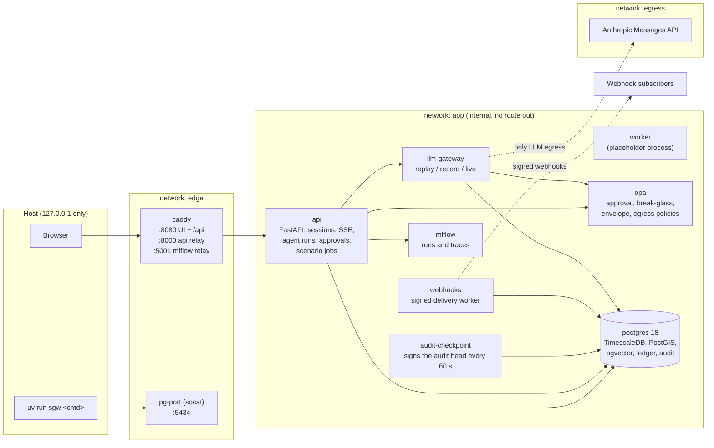
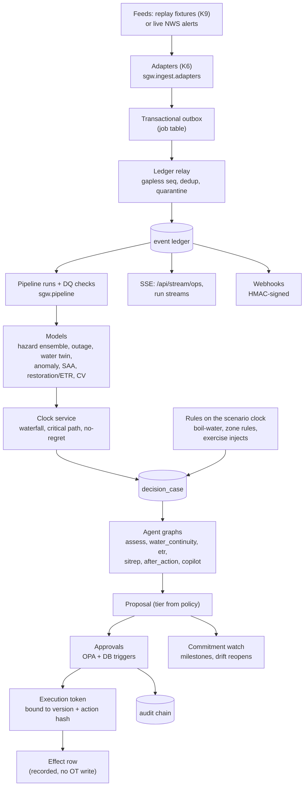
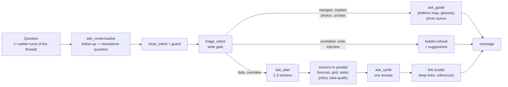

# Architecture

Audience: an engineer who will run, review or extend the prototype. It describes `main` as it is; parts that are not built yet are marked.

The platform turns feeds (weather, outage management, SCADA, AMI, field service, asset management, lab results, GIS) into **decision cases**. Each case carries a computed **decide-by clock**: the time by which a named action must be approved, so that its lead time still fits before the consequence. People approve actions at a tier set by policy, and every step lands in a hash-chained audit trail.

Three rules shape the whole design:

1. **Models predict, code computes, the LLM explains.** Forecasts come from statistical and physical models, clocks and rankings from deterministic code, and LLM text only explains values that code has already put into slots. A verifier rejects any model text with a digit it cannot trace.
2. **Authority is a database row.** Policy (OPA) decides who may approve, and Postgres triggers check the same rules again on insert. An action runs only with a single-use execution token bound to the approved proposal version and its action hash.
3. **One process talks to the LLM provider.** The LLM gateway is the only service that reaches the LLM provider and the only holder of the API key; the only other service on the egress network is the webhook worker. Replay mode needs no key.

The decisions behind these rules are in [docs/adr/](adr/README.md).

## Container view

Mermaid source above; the PRD carries the same view as a TikZ figure (`docs/latex/shared/diagrams/container.tex`). Service limits, images and ports: [docs/ops/stack.md](ops/stack.md).

| Service | Role | Code |
| --- | --- | --- |
| caddy | The only HTTP entry: serves the web app built from `web/` (its image builds it with the frozen lockfile), proxies `/api`, sets CSP on the UI origin; relays for the API and MLflow | `infra/caddy/`, `docker/caddy/Dockerfile` |
| api | REST and SSE API, sessions, scenario clock, agent runs, approvals, audit, ops, `/v1` integration API; a scenario-jobs loop every 5 s raises rule and exercise decisions as the scenario clock moves | `src/sgw/api/`, `src/sgw/api/scenario_jobs.py` |
| worker | Starts the shared image's placeholder; background jobs run from the CLI today (see [limitations](limitations.md)) | `docker/python/placeholder.py` |
| webhooks | Delivers signed webhooks from the delivery table (`sgw integrations worker`) | `src/sgw/integrations/delivery.py` |
| audit-checkpoint | Signs the audit chain head with Ed25519 and writes anchor files outside the database | `src/sgw/approval/audit.py` |
| llm-gateway | Messages API proxy: egress policy, record and replay, budget stops, breaker, `llm_call` rows | `services/llm_gateway/` |
| opa | Policy decisions for approvals, break-glass, envelopes and LLM egress | `policy/*.rego` |
| postgres | Every table: event ledger, observations (hypertable), decision cases, proposals, audit, RAG chunks, LangGraph checkpoints, Ask threads. The image also carries H3, pgRouting and pgvectorscale; only `sgw db-smoke` exercises them, no migration or application code uses them | `db/migrations/`, `docker/postgres/` |
| pg-port | TCP relay so host tools reach Postgres on 5434 while Postgres stays on the internal network | `compose.yaml` |
| mlflow | Run tracking for models and agent traces | `docker/mlflow/` |

An optional `obs` profile adds Prometheus, Grafana, cAdvisor and a Postgres exporter (`uv run sgw obs up`). It is not part of the core stack. Without it, Admin > System metrics shows the API's own request counts and response times since the process started (`GET /api/admin/system`, kept in memory by the API's metrics middleware), and an "Open Grafana" link appears only while the profile answers.

## Data flow

1. **Ingest.** Adapters implement one port (K6) with an opaque cursor. Replay adapters read the committed fixtures and gate events by the scenario clock; fault flags (`FAULT_FEED_GAP`, `FAULT_FEED_DELAY` and others) inject gaps, delays, duplicates and schema drift. The NWS alerts adapter is the one live adapter.
2. **Ledger.** Producers write to a transactional outbox in their own transaction. One relay numbers events under an advisory lock, so the ledger stays gapless even when a batch rolls back. `uv run sgw replay` prints the ledger head, a gapless flag and its SHA-256.
3. **Pipeline runs and data quality.** Assets have dependencies and lineage. Each run writes `pipeline_run` and `dq_check` rows and emits its own ledger events in the same transaction.
4. **Models.** Each model writes versioned outputs; [data](data.md) lists what each one is trained or calibrated on.
5. **Clocks.** `consequence time - action lead time = decide-by`, per ensemble member, then P10/P50/P90. A backward pass over the prerequisite graph gives the effective decide-by (critical path). The no-regret verdict offers "wait for the next advisory" only when that advisory lands before the earliest P10 effective decide-by of the case and all its prerequisites.
6. **Rules and exercise injects.** The API's scenario-jobs loop runs the boil-water and zone rules (`SGW_ZONE_RULES`) and the scripted exercise injects (`SGW_SCENARIO_INJECTS`, both on in the stack) against the scenario clock. Injects are 31 timed decisions with rule deadlines and 20 synthetic facilities on the Helene timeline, raised by a proposer limited to a few action types, with the `PRP-EX-` prefix, so every signing role has work at each moment. They are scripted exercise data, not model output.
7. **Agent graphs.** LangGraph graphs share one spine: `load_context -> input_guard -> call_tool (fan-out) -> fuse -> optimise -> narrate -> draft_rationale -> verify -> policy_gate -> approval (interrupt) -> execute -> audit`. Graph state lives in the LangGraph Postgres checkpointer, so a run paused for approval survives an API restart.
8. **Approvals.** The proposal's tier and required functions come from policy, never from the client. Approvals use compare-and-set on the proposal version (`If-Match`). T3 needs two people from two different functions, neither of them the proposer.
9. **Audit.** Every state change appends to a hash-chained `audit_event` table (insert-only for the runtime role). Signed checkpoints and anchor files let `uv run sgw audit verify` (or `POST /api/audit/verify`) report the first bad sequence after tampering.
10. **Out.** Server-to-client streaming is SSE (`/api/stream/ops` and one stream per agent run, both resumable with `Last-Event-ID`). External systems use the `/v1` API with scoped read tokens and HMAC-signed webhooks (`decision.approved`, `clock.breached`, `commitment.drifted`); the contract is `contracts/openapi-v1.json`. The `/v1/events` SSE subscription, secret rotation, the delivery log and the token list and revoke routes are built and tested but marked `x-sgw-status: proposed`, so the served app mounts them only once the K3 contract lists them.

## Trust boundaries

| Boundary | Control | Where |
| --- | --- | --- |
| Host to stack | Every port bound to 127.0.0.1; Postgres reachable only through the relay | `compose.yaml` |
| Stack to Internet | `app` network is internal; only `llm-gateway` (LLM provider) and `webhooks` (subscriber URLs, private and loopback targets refused by `src/sgw/integrations/urls.py`) join `egress` | `compose.yaml`, [ops/stack.md](ops/stack.md) |
| Data to LLM | Egress policy per call: data classes per route (R1 allows C0/C1), node allowlist, canary and secret detectors; fails closed | `policy/egress.rego`, `services/llm_gateway/egress.py`, [gateway.md](gateway.md) |
| LLM to operator | Slot rendering and the verifier: no digit, number word, link or authority claim the run cannot trace | `src/sgw/agent/render/verify.py` |
| Untrusted text to LLM | RAG and note guards withhold instruction-shaped lines; free-text notes in a run are quarantined and the run is marked tainted, which the approval card states; the copilot holds read-only tools only | `src/sgw/agent/rag/guard.py`, `src/sgw/agent/extract/guard.py`, `src/sgw/agent/copilot/tools.py` |
| Operator to action | OPA tier policy, then DB triggers on approvals, execution tokens, effects and break-glass rows | `policy/approval.rego`, `db/migrations/0005_*.sql`, `4500_*`, `4501_*`, `4750_*` |
| Process to DB | Separate logins: owner (migrations), `sgw_runtime` (API, ledger insert-only, audit insert-only), `sgw_gateway` (insert on `llm_call` only) | [ops/stack.md](ops/stack.md) "Database layout" |
| Platform state | Kill switch K0-K4 and degraded modes M0-M4 enforced in the database; restore needs `command` + `compliance` | `db/migrations/5000_ops_control.sql`, `src/sgw/ops/` |

## Approval tiers

| Tier | Meaning | Example |
| --- | --- | --- |
| T0 | Read, what-if, Q&A; logged | Risk view |
| T1 | A person promotes a draft | Work-order draft; re-optimisation inside an approved envelope |
| T2 | One approver from a named function | Event type (`command`) |
| T3 | Two approvers from two functions, neither the proposer | Crew pre-positioning (`command` + `logistics`); PS-17 feeder priority (`command` + `water_operations`); boil-water notice (`water_operations` + `compliance`); global ETR (`command` + `operations`) |
| T3 emergency approval ("break-glass" in code) | Incident Commander alone with a reason; co-sign by the second function within 24 h; flagged in the after-action review | Any T3 action |
| T4 | No tool exists | Direct control of field equipment |

The tier table is generated into `policy/sgw/tiers/data.json` (`uv run sgw policy-data`) and tested table-driven in `policy/approval_test.rego`.

## Contracts

`src/sgw/contracts/` is the source of truth for the event envelope (K2), API models (K3), SSE wire format (K4), agent tools (K5), adapter port (K6), vocabularies (K7), approval semantics (K8), fixture format (K9), numbers (K10), decision case and clock (K16), eval reports (K17) and seeded identities (K18). Generated artefacts are committed and drift-checked: [contracts/README.md](../contracts/README.md).

## Degraded operation

| Mode | Entered by | Behaviour |
| --- | --- | --- |
| M0 | normal | everything available |
| M2 | LLM down (`FAULT_LLM_DOWN=1` or gateway breaker open) | narration and drafts fall back to templates filled with the same slot values; clocks and approvals unaffected |
| K1-K4 | kill switch (IC, Duty Manager, Water Lead or Executive) | stepwise removal of execution, agent runs, ingestion and new proposals; restore needs two signatures from `command` and `compliance` |

`uv run sgw ops rules` prints the full mode ladder, signal table and capability matrix.

## Ask AI

Ask is the `copilot` graph with the `team` engine, read-only end to end: no node drafts, proposes, approves or executes anything, and the graph has no approval step.

- **Gate.** The first router (`route_intent`) decides the in-scope intent; the wide gate (`src/sgw/agent/route/gate.py`) gives every question it sent out of scope a second look. Code decides first (write requests, instruction-like text, photo and "where can I find" questions), then a small model picks one of overview, data, photos, navigate, explain, unclear, unrelated or write and returns two or three "did you mean" readings. Only unrelated topics, write requests and injected instructions are declined, always with what Ask can do and three suggested questions.
- **Team.** The planner (`plan.py`) assigns parts of the question to at most three workers per wave, with an optional second wave; code drops workers the signed-in role may not use. Each worker (`workers.py`) pre-fetches its evidence by code through read-only tools, then takes a few model steps. Synthesis (`synthesis.py`) merges the findings in a fixed order, so the replay hash does not depend on which worker finished first, and writes one answer that the same verifier checks as every other node.
- **Guide.** The guide path (`guide.py`) answers navigation, definitions and photo requests from the platform map (`platform_map.yaml`, pages the role can open), the Help glossary and the damage-photo queue. Code builds the deep links, inline photos and suggestions; the writer never writes a link.
- **Language and follow-ups.** Questions in Polish, German, Spanish or French get an answer in that language (`language.py`); English requests are byte-identical to the recorded ones. A follow-up that leans on the conversation ("or the link", "and for PS-23?") is rewritten into a standalone question, keeping every id the user typed.
- **Models.** Haiku for the router, gate, follow-up rewrite and planner; Sonnet for the workers, synthesis and the guide (`src/sgw/agent/llm_nodes.yaml`). Every model step has a code fallback, and caps on calls, spend, waves and wall clock (`budget.py`).
- **Replay.** Recordings are keyed by the full request, which includes the prompt text, the tool results and the scenario time. A change to any tool result needs a re-record. In the demo stack a replayed call waits for the time the live call took when it was recorded (`latency_ms` in the fixture, at most `LLM_REPLAY_PACE_MAX_S`, 12 s with `sgw up --demo`, 0 in tests), so a replayed answer takes as long as the live one did. The Ask page names the step that is really running from the run's own frames ("Reading the question", "Choosing what to check", "Checking water service", "Writing the answer"; `web/src/features/ask/StepsLine.tsx`).
- **Role.** The planner, workers and synthesis see a reader line (`reader.py`): the signed-in role, its team, whether it signs or only reads, and the pages it can open. An answer names the decisions that role signs, says who signs the others, and links only pages the role can open. The Operations duty managers also get the water tools.
- **One customers-out figure.** `get_outages` leads with the county total of the replay, the same figure Briefing shows; the open outage events in SGW's own feeder log are a second, plainly named measure.
- **The platform's own models.** "How does the outage forecast work?" or "How reliable is the surge detector?" goes to the guide, which answers from a model card per model (`model_cards.yaml`: outage forecast, surge detector, water anomalies, photo triage, crew plan, water twin, ETR) with its method, inputs, provenance and measured quality; every figure comes from the numbers registry.
- **Photos.** Before landfall Ask says that field photos come in after landfall, as Crews does, and shows example photos from other storms only when asked for them, labelled as examples.

## Web UI

React and TypeScript (Vite, Tailwind CSS, shadcn/ui on Radix, MapLibre GL), built into the Caddy image and served on 127.0.0.1:8080. It talks only to the API through `/api`, follows [DESIGN.md](../DESIGN.md), and reads the signed-in person's permissions from `GET /api/me/permissions`, so buttons a role may not use are not shown. Modules: Decisions, Map, Forecast, Crews, Water, Ask AI, Briefing, After-action, System health, Readiness, Notifications, Admin and Help (`web/src/app/modules.ts`). The top-bar scenario chip shows the scenario period on every page; the presenters (Incident Commander and the two Duty Managers) can load another demo moment or scenario from it.

## Scenarios

The active scenario is part of the scenario clock (`control_state.scenario_clock`), so every user sees the same one; the default is the Helene replay. A scripted exercise is a pack of YAML files under `data/scenarios/` (Hurricane Ian 2022: `data/scenarios/ian-2022/pack.yaml` and `msel.yaml`), loaded by `src/sgw/scenarios/packs.py` and read by `src/sgw/scenarios/reads.py`.

- **Load.** `POST /api/demo/scenario` (presenters, demo mode only) copies the quiet Helene template of the first story moment, then switches the clock to the pack's first moment, so no Helene decision or signature is carried over. Back to Helene loads the saved `at-n1` moment. Both go through the same template copy as "Load moment".
- **What a pack holds.** The period and three moments (day before landfall, landfall near Georgetown, morning after landfall); the HURDAT2 best track (no cone); a scripted county outage curve and the critical facilities it takes down; a crew roster; and a master scenario events list of eleven timed decisions raised through the exercise-inject engine with rule deadlines, so every signing role has a decision.
- **Pages.** Decisions, Map, Briefing and Notifications read the pack when it is active; Crews (read-only roster) and After-action (the exercise's own deadlines, emergency approvals and timeline) too (`PACK_PAGES` in `web/src/lib/scenarios.ts`). Forecast and Water show "Not modelled for this scenario" (`HELENE_ONLY` in `web/src/app/ScenarioGate.tsx`). Every pack figure is labelled "Scripted exercise data (synthetic)".
- **Ask.** On a pack the tools read the pack (`PackReads` in `src/sgw/agent/tools/reads.py`): its decisions, county customers out, facilities and crews; forecasts, risk, water and photos answer "not modelled for this scenario".

