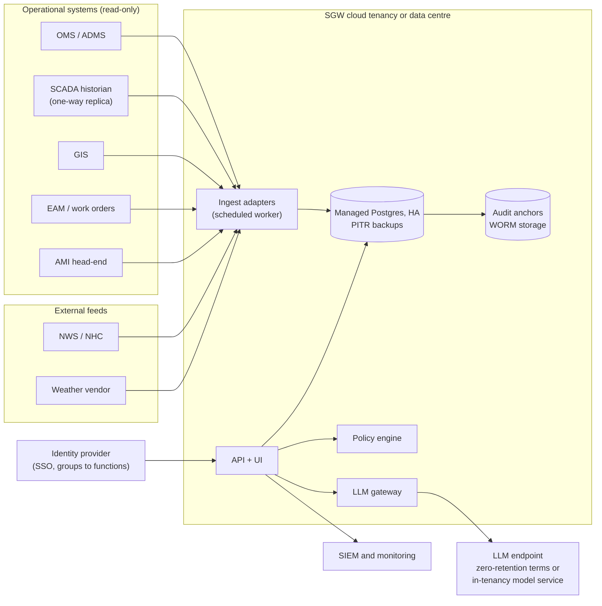

# Trade-offs and the minimum pilot architecture

Audience: the technical delivery team and the architects who would take the prototype to a pilot. The first part lists the choices made for the prototype, what each one costs, and when to revisit it. The second part proposes the smallest architecture that could run a real pilot. Both are proposals for discussion, not commitments.

## Prototype trade-offs

| Choice | Gained | Given up | Revisit when |
| --- | --- | --- | --- |
| Decision clocks as the core object ([ADR 0001](adr/0001-decision-clocks-as-the-core.md)) | Every screen answers "what must be decided, by when, and why"; the basis is inspectable | Models must emit distributions; cases with too few members reaching the consequence show no clock | Users ask for a plain risk view as the entry point |
| Authority enforced by policy and DB triggers ([ADR 0002](adr/0002-authority-is-a-database-row.md)) | An agent or a buggy route cannot create an approved action | Rules exist twice (Rego and PL/pgSQL) and need parity tests | The approval model moves into the utility's workflow system |
| LLM explains through slots ([ADR 0003](adr/0003-llm-explains-never-decides.md)) | No untraceable number reaches an operator; a template path with the same values | Some correct prose is rejected; prompts are part of the replay contract | Verifier rejection rates on held-out sets are known |
| One egress gateway ([ADR 0004](adr/0004-single-egress-gateway.md)) | One place for keys, data classes, budget and audit rows; keyless replay | An extra service; a replay miss falls back to templates | The utility mandates its own AI gateway |
| Postgres only ([ADR 0005](adr/0005-postgres-only-light-stack.md)) | Runs on one laptop; one store to secure and back up; no dual writes | A single point of failure; ledger throughput bounded by one relay | Sustained ingest beyond what one relay handles, or many independent consumers |
| SSE plus REST ([ADR 0006](adr/0006-sse-over-websocket.md)) | Resumable streams over plain HTTP; writes stay idempotent and auditable | No client-to-server push channel | A field app needs offline sync |
| Replay of a real storm on synthetic SGW data | Repeatable demos and tests; real Helene track and county outages as calibration | Behaviour on SGW's real assets is unknown | Phase 0 data access |
| Precomputed what-if grid (81 cells) instead of live simulation | Instant answers in the demo | Only the four grid dimensions can be varied | Users need other levers |
| Reduced water twin instead of EPANET at run time | Fast enough for every ensemble member | Valid only for one tank per zone with the pump off | The utility shares its hydraulic models |
| Two-stage stochastic optimisation (SAA) for crews | Plans that hedge across forecast members, with the value of the stochastic solution reported | Solve times of seconds to tens of seconds; no road network | Crew routing is in scope |
| Ask AI as a read-only team (router, wide gate, planner, parallel workers, synthesis, guide) instead of one model loop | Answers that combine forecast, grid, water and policy evidence; helpful refusals; deep links built by code | More model calls per question (a few cents live) and more recordings to keep in step | The question bank shows the single loop is as good |
| `replay_then_live` for the demo | Recorded questions cost nothing and never change; new questions still get a real answer | A spend cap and a key file to manage; unrecorded answers vary | A hosted demo needs a shared key |
| Scripted exercise injects on the Helene timeline instead of more generated storms | Every signing role has decisions at each moment within hours of work | Inject numbers are scripted, not modelled, and labelled so | Scenario packs with their own generated worlds |
| Hurricane Ian as a scripted exercise pack on the real track instead of a second generated replay | A second storm every role can work in, within a day of work, without touching the Helene demo | Forecast and Water are not modelled for it; outages, facilities and crews are scripted | A generated Ian world with its own network, run through the same models |
| Replayed Ask answers paced at their recorded duration instead of instantly | The demo shows how long the agent team really takes, with the real step names | A replayed answer is slower than it could be | Instant replay (looked mocked) |
| In-app API metrics instead of starting Prometheus and Grafana from the UI | No privileged helper with Docker rights; nothing to start or stop | Counts reset with the API process; no history | The pilot's monitoring takes the counters |
| Reinforcement learning not used | No simulator-trained policy with unclear failure modes in a safety-relevant loop | Possible gains in sequential dispatch | A validated restoration simulator and years of outcome data exist |

## Minimum pilot architecture

**Scope [A].** One electric operating area and one water system with its pump stations, one hurricane season, read-only integrations, the decision queue for the five storm decisions, and the after-action review. People keep the systems of record; the platform proposes, explains, clocks and records.

| Component | Pilot choice | Change from the prototype |
| --- | --- | --- |
| Hosting | Containers on the utility's existing platform (a managed container service or its Kubernetes, whichever it already runs) | Compose on a laptop becomes a deployment with health checks and rolling updates |
| Database | Managed or Patroni-run Postgres with high availability and point-in-time recovery; the eight extensions verified on the chosen service first | Single instance becomes a replicated pair |
| Identity | SSO (OIDC or SAML) from the utility's identity provider; directory groups map to the ten functions (command, operations, planning, logistics, water_operations, compliance, executive, audit, data, platform) | Demo users and the persona switcher are removed |
| Integrations | Read-only adapters per system behind the existing K6 port: OMS, SCADA historian replica, GIS, EAM, AMI, NWS/NHC, one weather vendor | Replay adapters stay for drills and training |
| OT boundary | No write path; the SCADA feed comes from a historian replica outside the control network | Same rule as the prototype (T4 has no tool) |
| LLM | Through the gateway to a provider endpoint on zero-retention terms, or a model service inside the tenancy; route R2 for C2 data with pseudonymisation | Replay remains for tests |
| Audit | Checkpoint anchors to write-once object storage; chain verification in the nightly job | Local anchor files become WORM storage |
| Operations | The `obs` profile's metrics feed the utility's monitoring; security events to its SIEM; kill-switch drills each quarter | Same kill switch and degraded modes |
| Background jobs | One scheduled worker for ingest, pipelines, commitment watch, webhooks and optimisation jobs | Replaces the CLI-started loops |

**Explicitly not in the pilot [A].** A log broker such as Kafka (Postgres handles one area's event rate; revisit when several regions or many consumers share the ledger), a field mobile app, public notice sending (drafts only), crew routing, multi-region deployment, and model retraining pipelines beyond the scheduled backtests.

**Entry conditions [A].** Data-sharing agreement and read access to the five systems; the utility's lead-time values and approval tiers reviewed by operations and compliance (every policy value in the prototype is labelled "Assumed SGW policy"); a decision on which data classes may leave the tenancy; a named owner for each of the five decisions.
